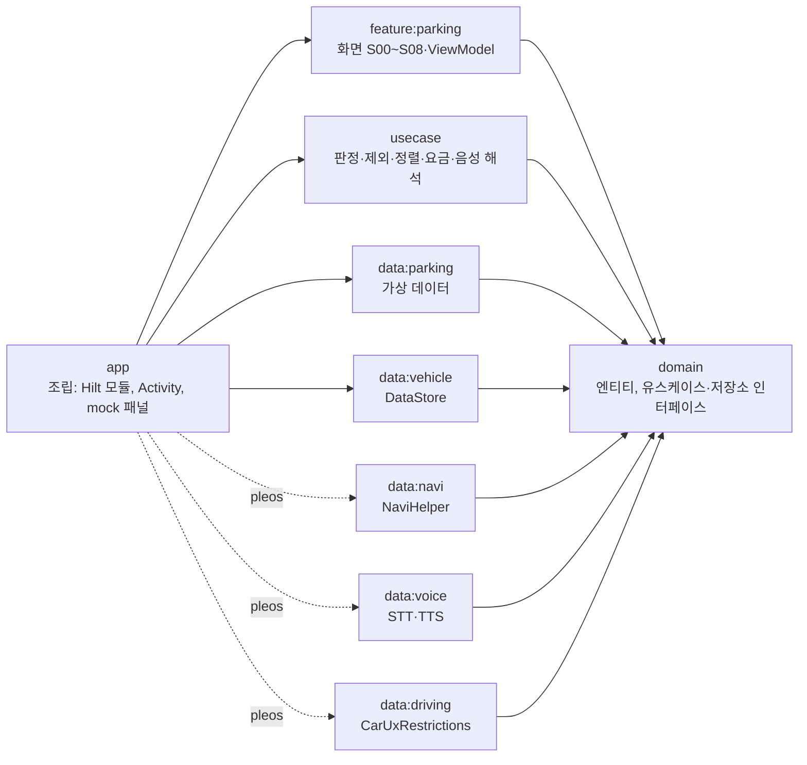

# 주차까지 (가칭)

내비 목적지의 주차 지원 여부와 주변 주차장의 이용 조건(차량 크기·주차 방식·잔여 대수·요금)을 비교해 고르고, 차량 도착지를 그 주차장 입구로 바꿔 주는 차량용 앱. 현대자동차그룹 차량용 앱 개발 공모전 출품작이며 Pleos Connect(AAOS)에서 돈다. 형제 저장소 `../dropByExhibit`(들러가는 전시)과 구조·SDK 어댑터를 같이 쓰지만 기획이 달라 별도 프로젝트다.

기획서: 「주차까지 차량용 앱 화면 시안 기획서」(2026-11-01). 규칙의 정본은 [docs/specs/parking-guidance.md](docs/specs/parking-guidance.md).

## Pleos 에뮬레이터와 이 앱의 관계

Pleos Connect 에뮬레이터는 Android Studio 안에서 도는 차량(AAOS) 가상 기기다. 앱을 대신하는 것이 아니라 앱을 설치해서 돌리는 **대상 기기**이고, Virtual Console은 기어·도어·배터리 같은 차량 상태를 가상으로 바꿔 앱의 반응을 보는 도구다. 그래서 앱(이 저장소)은 필요하고, 에뮬레이터는 검증 환경이다. 기획서 27절도 Kotlin·Compose 앱과 mock/pleos 빌드 변형을 요구한다.

## 실행 방법

1. Android Studio에서 이 폴더를 연다. Gradle 9.6, AGP 9.4.1(형제 저장소와 같은 버전).
2. 루트의 `local.properties`에 아래 값을 넣는다. 이 파일은 저장소에 올리지 않는다.

   ```properties
   sdk.dir=<Android SDK 경로>
   # Pleos Playground My Project의 Client ID·Secret. 비우면 음성은 온디바이스 엔진만 쓴다. (pleos 플레이버)
   pleos.clientId=
   pleos.clientSecret=
   ```

3. 빌드 변형 둘(기획서 27절):
   - `mockDebug` — 가상 데이터·가상 차량 상태. 폰 에뮬레이터에서 화면 전부를 확인한다. 화면 위 보라색 띠(MOCK 환경)로 주행 상태·내비 목적지·만차·음성 입력을 바꾼다. `./gradlew :app:installMockDebug`
   - `pleosDebug` — 실제 Pleos SDK(NaviHelper·STT·TTS·CarUxRestrictions). Pleos Connect 에뮬레이터용. `./gradlew :app:installPleosDebug`

단위 테스트: `./gradlew :usecase:test`

## 확인한 것 / 확인 전인 것

| 항목 | 상태 |
|---|---|
| `:usecase:test` | README 작성 시점 결과는 완료 보고에 적는다 |
| `:app:assembleMockDebug` | 같음 |
| Pleos Connect 에뮬레이터 | 이 맥(M1 Max)에서 부팅 15초 뒤 멈추는 문제가 미해결이라 pleos 플레이버는 미확인 |
| 서버 v1 API | 없음. 규칙은 클라이언트(usecase)가 계산하고 데이터는 가상이다 |
| 공공 주차장 API(TS 주차정보·전국주차장 표준데이터·TourAPI) | 미연결 |
| 화면 S04·S09·S10·S12·S13·S14, S00 직접 검색 | 미구현 |

## 구조

클린 아키텍처로 계층을 나누고, 의존은 안쪽(domain)으로만 향한다. 외부 SDK 하나는 data 모듈 하나에서만 import한다. Pleos SDK 모듈은 pleos 플레이버에만 들어가고 mock APK에는 SDK가 없다.



| 모듈 | 하는 일 | 외부 의존 |
|---|---|---|
| `domain` | 엔티티, 저장소·유스케이스 인터페이스, 오류 어휘. 순수 Kotlin | 코루틴 |
| `usecase` | 차량 제한 판정, 잔여 상태, 요금, 제외·정렬, 검색·재조회, 반경 확대, 페이지, 입력 검증, 음성 해석, 목적지 변경 분류 | 없음 |
| `feature:parking` | 화면 S00·S01·S02·S03/S11·S06·S07·S08과 ViewModel(단일 상태 저장소). domain 인터페이스만 본다 | Compose, Hilt |
| `data:parking` | 기획서 24절 가상 주차장 데이터. 서버가 생기면 같은 인터페이스의 HTTP 어댑터 | 없음 |
| `data:vehicle` | 차량 프로필 저장(version 증가) | Jetpack DataStore |
| `data:navi` | 목적지 조회·변경 이벤트, 경로 변경 요청과 결과 확인 | Pleos NaviHelper |
| `data:voice` | 음성 안내, 음성 답 한 번 듣기 | Pleos STT·TTS |
| `data:driving` | 주행·정차·불명 (주행 규제 상태) | AAOS `android.car` |
| `app` | 의존 그래프(`di/AppModules.kt` + 플레이버별 `di/EnvModule.kt`), 매니페스트, mock 패널 | Hilt |

## 형제 저장소와 공유하는 것

`data:navi`·`data:voice`·`data:driving`은 dropByExhibit의 어댑터를 복사해 이 앱의 인터페이스에 맞췄다. 공유 라이브러리로 묶지 않은 이유는 두 출품작이 따로 제출되고 SDK 버전을 각자 올릴 수 있어야 해서다. 한쪽에서 SDK 쓰는 법을 배우면 다른 쪽에도 손으로 옮긴다.
