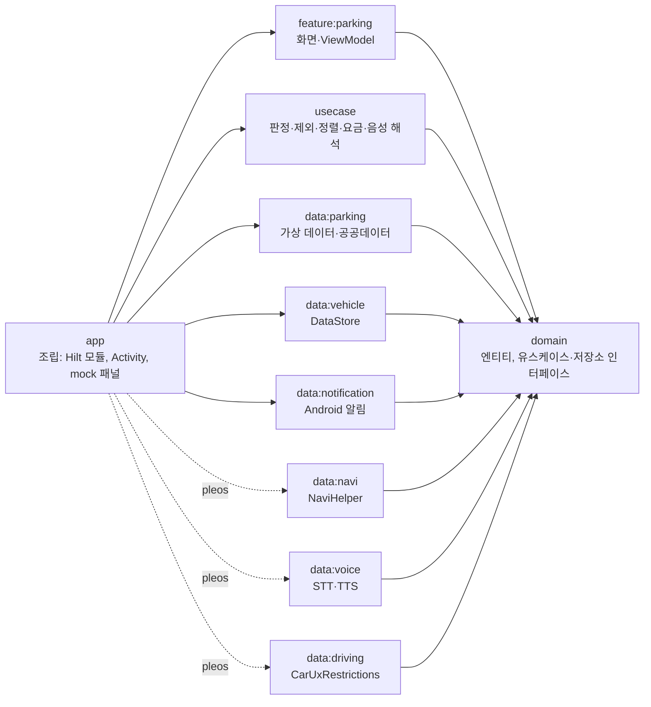

# 주차까지

현재 목적지에 내 차에 맞는 이용 가능한 주차장을 찾아주고 안내해주는 앱입니다.

현대자동차그룹 차량용 앱 개발 공모전 출품작입니다(팀 파킹). Pleos Connect(AAOS)에서 동작하는 Kotlin·Jetpack Compose 앱으로, 내비게이션 목적지 주변의 주차장을 내 차 조건에 맞게 걸러 비교한 뒤 선택한 주차장의 입구로 내비게이션 도착지를 바꿉니다.

## 주요 기능

| 기능 | 하는 일 |
|---|---|
| 목적지 알림 | 내비게이션에서 목적지를 설정하면 앱을 열어 두지 않아도 '주변 주차장 보기' 알림이 뜹니다. 알림을 누르면 해당 목적지의 주차장 비교 화면이 열립니다. |
| 목적지 직접 검색 | 내비게이션 목적지가 없는 상태에서 정차 중일 때 "어디로 갈까요?"라고 묻고, 들은 장소 이름으로 내비게이션 장소 검색을 엽니다. |
| 주변 주차장 비교 | 진입할 수 없다고 확인된 곳은 제외하고, 후보를 다섯 곳씩 남은 자리·혼잡도·거리·요금 기준으로 비교합니다. 정보가 없는 항목은 '미확인'으로 표시합니다. |
| 주차 조건 | 기계식 주차장을 뺄지, 방식이나 잔여 정보가 없는 곳을 넣을지, 예상 주차 시간(30분~4시간)을 고릅니다. |
| 차량 제한 판정 | 내 차의 높이·폭·길이·중량을 주차장의 제한 기준과 비교합니다. 제한 정보가 없으면 '차량 제한 미확인'으로 표시합니다. |
| 음성 조작 | 앱 내 음성 버튼으로 조건 변경, 페이지 넘김, 후보 선택을 수행합니다. |
| 안내 직전 재조회 | 선택한 주차장만 다시 조회합니다. 자리가 있으면 도착지를 주차장 입구로 바꾸고, 그사이에 만차가 되었으면 기존 경로를 유지한 채 대체 후보를 보여 줍니다. |
| 도착 후 혼잡도 입력 | 안내받은 주차장에 도착해 정차하면 혼잡·보통·원활을 한 번 묻고, 최근 2시간 평균을 후보 목록에 표시합니다. |

기능별 세부 규칙은 `docs/specs/`에서 확인할 수 있습니다: [주차장 안내](docs/specs/parking-guidance.md), [공공 주차장 데이터](docs/specs/public-parking-data.md), [실시간 잔여 대수](docs/specs/realtime-availability.md), [혼잡도 입력](docs/specs/congestion-report.md), [목적지 직접 검색](docs/specs/destination-search.md), [목적지 알림](docs/specs/destination-alert.md).

## 실행 방법

빌드 변형은 두 가지입니다.

| 변형 | 용도 | 패키지 | 런처에 보이는 이름 |
|---|---|---|---|
| `pleos` | 실제 Pleos SDK(NaviHelper·STT·TTS)와 공공데이터를 사용합니다. Pleos Connect 에뮬레이터용이며, 심사 때 확인할 변형입니다. | `app.untilparking` | 주차까지 release / 주차까지 debug |
| `mock` | 가상 데이터와 가상 차량 상태로 전체 화면을 확인합니다. Pleos SDK가 포함되어 있지 않아 일반 Android 에뮬레이터에서도 동작합니다. | `app.untilparking.mock` | 주차까지 mock release / 주차까지 mock debug |

### APK로 실행하기

1. Android Studio의 Device Manager에서 Pleos Connect 에뮬레이터를 실행합니다. 버전은 아래 「Pleos Connect 에뮬레이터 버전과 화면 규격」과 같습니다.
2. 접수 메일에 첨부한 pleos 빌드 APK를 설치합니다.

   ```bash
   adb install -r <pleos APK 경로>
   ```

3. 앱 목록에서 **주차까지 release**를 엽니다. 알림 권한을 묻는 창이 뜨면 허용합니다.
4. 에뮬레이터의 내비게이션에서 목적지를 설정합니다. 앱이 화면에 열려 있으면 주변 주차장 비교 화면이 나타나고, 열려 있지 않으면 '주변 주차장 보기' 알림이 뜹니다. 목적지가 없을 때는 목적지 대기 화면이 표시됩니다.
5. 후보 항목을 누르면 해당 주차장만 다시 조회한 뒤 내비게이션 도착지를 주차장 입구로 바꿉니다.

첫 조회 시 전국주차장정보 표준데이터 18,994건을 내려받아 기기에 저장하므로 인터넷 연결이 필요합니다. 2026-11-09 확인 기준 약 10초가 걸렸습니다. 검색은 목적지 반경 500m에서 시작하며, 후보가 없으면 화면에서 1,000m, 2,000m로 넓힐 수 있습니다. 표준데이터에 등록된 주차장이 적은 지역에서는 500m 이내에 후보가 없을 수 있습니다.

### 소스에서 빌드하기

1. Android Studio에서 이 폴더를 엽니다.
2. 루트에 `local.properties` 파일을 만들고 아래 「필요한 설정」의 값을 입력합니다.
3. 원하는 변형을 선택해 설치합니다.

   ```bash
   ./gradlew :app:installPleosDebug   # Pleos Connect 에뮬레이터
   ./gradlew :app:installMockDebug    # 일반 Android 에뮬레이터
   ```

mock 빌드는 화면 상단의 보라색 띠(MOCK 환경)에서 주행 상태, 내비 목적지, 만차 여부, 음성 입력을 바꿔 가며 동작 흐름을 확인할 수 있습니다.

## 테스트 환경 및 필요한 설정

### 테스트 환경

| 항목 | 값 |
|---|---|
| 호스트 | macOS 27.2.1, Apple Silicon(M1 Max) |
| Android Studio | 2026.2 |
| JDK | 23 (명령줄 빌드), Android Studio 내장 JDK 25 |
| Gradle / AGP / Kotlin | 9.6.0 / 9.4.1 / 2.2.10 |
| compileSdk / targetSdk / minSdk | 37 / 37 / 28 |
| Pleos SDK | NaviHelper 3.0.5, SpeechToText 3.3.1, TextToSpeech 3.3.1 |
| Android Emulator | 37.2.12 |
| 대상 기기 | Pleos Connect 에뮬레이터 v2.1.0 (아래 절) |

단위 테스트는 규칙을 계산하는 `usecase` 모듈과 공공데이터 어댑터가 있는 `data:parking` 모듈에 있습니다.

```bash
./gradlew :usecase:test :data:parking:testDebugUnitTest
```

2026-11-15 실행 기준 `usecase` 149개, `data:parking` 55개 테스트가 모두 통과했습니다.

### 필요한 설정

소스에서 빌드할 때는 루트의 `local.properties`에 아래 값을 입력합니다. 이 파일은 저장소에 올리지 않습니다.

```properties
sdk.dir=<Android SDK 경로>
# Pleos Playground My Project의 Client ID·Secret (pleos 변형). 비우면 음성은 온디바이스 엔진만 씁니다.
pleos.clientId=
pleos.clientSecret=
# 공공데이터포털 일반 인증키 (pleos 변형). 비우면 주차장 조회가 실패로 끝납니다.
parking.serviceKey=
```

`parking.serviceKey` 하나로 아래 네 출처를 호출합니다. 각 출처마다 공공데이터포털에서 활용신청을 따로 해야 합니다.

- 전국주차장정보 표준데이터: 위치, 유형, 요금, 운영 시간
- 한국교통안전공단 주차정보, 대전, 부산시설공단: 실시간 잔여 대수

Pleos Connect 에뮬레이터에서는 다음 항목을 준비합니다.

- 시스템 이미지: Android Studio SDK Manager의 SDK Update Sites에 Pleos Connect System Image 저장소를 등록하고, API 34의 "Pleos Connect v2.1.0 APIs arm64 System Image"를 내려받습니다.
- 인터넷 연결: 공공데이터를 내려받는 데 사용합니다.
- 마이크 접근 설정: 음성 조작과 목적지 직접 검색에 사용합니다.
- 알림 권한: 목적지 알림에 사용하며, 앱을 처음 열 때 허용 여부를 묻습니다.

앱이 선언하는 Pleos 권한은 `NAVI_ROUTE`, `NAVI_ROUTE_SEARCH`, `NAVI_CUSTOM_MAP`, `STT_SERVICE`, `TTS_SERVICE`입니다(모두 `pleos.car.permission.*`).

## Pleos Connect 에뮬레이터 버전과 화면 규격

| 항목 | 값 |
|---|---|
| 시스템 이미지 | Pleos Connect v2.1.0 APIs arm64 System Image (42dot, revision 2) |
| Android 버전 | API 34, Android Automotive OS |
| ABI | arm64-v8a |
| 기기 프로필 | Pleos Connect v2.1.0 (`Pleos_Connect_v2_0`) |
| 화면 | 12.8인치, 2560 × 1440 px, 160 dpi(mdpi), 가로 |
| Android Emulator | 37.2.12 |

앱은 가로 화면으로 고정되어 있습니다. 화면 시안은 1600 × 800 dp(160 dpi)를 기준으로 제작했고, mock 빌드의 화면 대조 역시 이 크기를 기준으로 진행했습니다. 최종 규격은 실제 차량 해상도에 맞춰 결정합니다.

## APK 파일 위치

APK는 접수 메일에 첨부해 제출하며, 저장소와 GitHub Release에는 올리지 않았습니다. 파일 이름으로 종류를 구분합니다.

| 파일 | 설치할 곳 |
|---|---|
| 이름에 `pleos`가 들어간 APK | Pleos Connect 에뮬레이터 (심사용) |
| 이름에 `mock`이 들어간 APK | 일반 Android 에뮬레이터 (화면 확인용) |

소스에서 직접 빌드하면 아래 경로에 APK가 생성됩니다.

```bash
./gradlew :app:assemblePleosDebug :app:assembleMockDebug
# app/build/outputs/apk/pleos/debug/app-pleos-debug.apk
# app/build/outputs/apk/mock/debug/app-mock-debug.apk
```

## 구조

클린 아키텍처로 계층을 나누었으며, 의존 방향은 안쪽(domain)으로만 향합니다. 각 외부 SDK는 하나의 data 모듈에서만 import합니다. Pleos SDK 모듈은 pleos 변형에만 포함되고 mock APK에는 들어 있지 않습니다.



| 모듈 | 하는 일 | 외부 의존 |
|---|---|---|
| `domain` | 엔티티, 저장소·유스케이스 인터페이스, 오류 어휘. 순수 Kotlin | 코루틴 |
| `usecase` | 차량 제한 판정, 잔여 상태, 요금, 제외·정렬, 검색·재조회, 반경 확대, 페이지, 입력 검증, 음성 해석, 목적지 변경 분류 | 없음 |
| `feature:parking` | 화면과 ViewModel(단일 상태 저장소). domain 인터페이스만 참조합니다 | Compose, Hilt |
| `data:parking` | 가상 주차장 데이터(mock), 전국주차장정보 표준데이터와 실시간 잔여 대수 어댑터(pleos) | 없음(JDK HTTP·Android org.json) |
| `data:vehicle` | 차량 프로필 저장 | Jetpack DataStore |
| `data:notification` | 목적지 알림 띄우기·지우기 | 없음(Android 알림) |
| `data:navi` | 목적지 조회·변경 이벤트, 경로 변경 요청과 결과 확인 | Pleos NaviHelper |
| `data:voice` | 음성 안내, 음성 응답 한 번 듣기 | Pleos STT·TTS |
| `data:driving` | 주행·정차·불명(주행 규제 상태) | AAOS `android.car` |
| `app` | 의존 그래프(`di/AppModules.kt` + 변형별 `di/EnvModule.kt`), 매니페스트, mock 패널 | Hilt |
