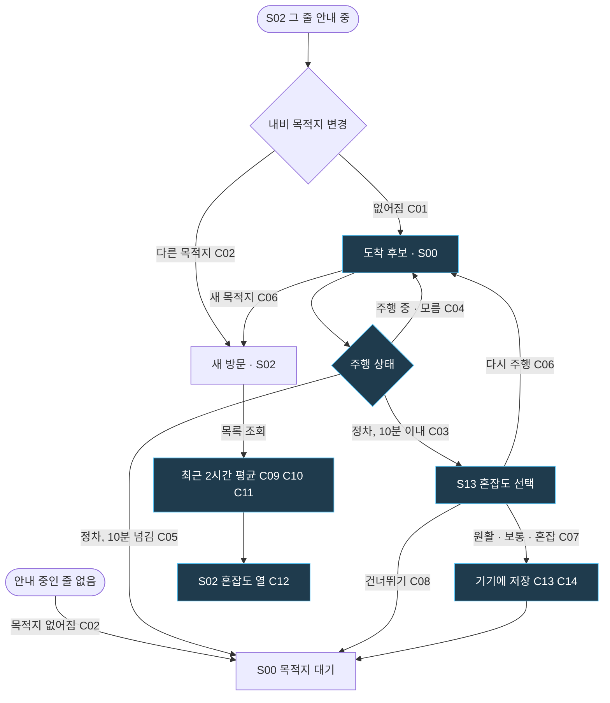

# 혼잡도 제보 스펙

안내받은 주차장에 도착한 운전자가 혼잡·보통·원활 중 하나를 고르고, 그렇게 모인 입력의 평균을 S02 표의 주차장 줄에 보여 준다. 공공 데이터에 잔여 대수가 없는 주차장이 많아 "남은 자리"가 "정보 미확인"으로만 보이는 것을 사람들의 입력으로 메운다. 기획서의 제보 화면(S13·S14, 시안 S02 카드의 "입차 대기 3명 제보 · 5분 전" 줄)을 이 기능으로 대신한다.

2026-11-14 사용자 결정 셋. ① 저장은 기기 저장과 가상 데이터로 화면과 흐름만 만들고 저장소 인터페이스를 분리해 서버는 나중에 끼운다. ② 도착은 안내 중인 주차장이 있는데 내비 목적지가 사라지고 차가 정차하면 도착으로 본다. ③ 평균은 최근 일정 시간 입력만 쓴다.

`[가설]`은 사람이 확인하기 전인 줄이다. 사용자가 "진행해줘"라고 해서 가설대로 구현했다.

## 무엇이 되면 끝인가

안내받은 주차장에 도착해 정차하면 혼잡도를 고르는 화면이 뜨고, 고른 값이 기기에 저장되며, 다음에 그 주차장이 S02 표에 나오면 최근 2시간 입력의 평균 혼잡도와 입력 수가 보인다.

## C1. 도착 판정

내비 SDK에는 도착 전용 이벤트가 없다. `onDestinationChanged`가 도착과 목적지 삭제 양쪽에 오고, 앱은 그 뒤 목적지를 다시 물어 "없음"을 받는다([주차장 안내 스펙](parking-guidance.md) R7 이벤트 표). 도착했을 때 실제로 목적지가 없어지는지는 Pleos 에뮬레이터에서 확인하지 못했다 `[가설]`.

| 상황 | 결과 |
|---|---|
| 그 줄이 "안내 중"인데 내비 목적지가 없어짐 | 도착 후보. 그 주차장과 그 시각을 기억한다. 화면은 R7대로 S00 |
| 안내 중인 줄이 없는데(고른 줄 없음·다시 시도·결과 확인 못 함) 목적지가 없어짐 | 도착 후보 아님. R7대로 S00 |
| 요청 중에 목적지가 없어짐 | 도착 후보 아님. R7대로 방문을 유지한다 |
| 안내 중인데 목적지가 다른 곳으로 바뀜 | 도착 후보 아님. R7대로 새 방문, S02부터 |
| 안내를 중간에 취소함 | 도착과 구분하지 못해 도착 후보가 된다(한계). 운전자가 "건너뛰기"로 넘긴다 |

## C2. 묻는 시점

| 상황 | 결과 |
|---|---|
| 도착 후보가 있고 정차 중(PARKED) | S13 혼잡도 선택 화면 |
| 도착 후보가 있고 주행 중(MOVING) | 묻지 않고 기다린다. 정차하면 묻는다 |
| 도착 후보가 있고 주행 상태를 모름(UNKNOWN) | 묻지 않고 기다린다. 정차로 간주하지 않는다(R9) |
| 묻는 중에 다시 주행 | 화면을 닫고 S00으로 가서 기다린다. 다시 정차하면 묻는다 |
| 도착 후보가 생긴 지 10분 뒤에 정차 | 묻는다 `[가설: 10분]` |
| 10분을 넘김(주행 중이어도) | 묻지 않고 도착 후보를 버린다. 다른 곳에 세운 차가 엉뚱한 주차장을 제보하지 않게 한다 |
| 묻는 화면이 떠 있는 채로 10분이 지남 | 닫지 않는다 `[가설]` |
| 기다리는 중에 새 내비 목적지가 잡힘 | 도착 후보를 버리고 R7대로 S02 |

## C3. 입력 (S13)

| 상황 | 결과 |
|---|---|
| 원활·보통·혼잡 중 하나를 누름 | 그 주차장, 고른 값, 지금 시각을 저장하고 S00. "혼잡도를 남겼어요" 한 줄 `[가설: 문구]` |
| 건너뛰기 | 저장하지 않고 S00. 다시 묻지 않는다 |
| 같은 도착에서 두 번 누름 | 한 건만 저장한다 |
| 저장 실패 | "혼잡도를 저장하지 못했어요" 한 줄, S00. 다시 묻지 않는다 `[가설]` |
| 버튼 설명 | 원활 "빈자리가 많아요", 보통 "빈자리가 조금 있어요", 혼잡 "빈자리를 찾기 어려워요" `[가설: 문구]` |
| 음성 | 음성으로는 고르지 않는다 `[가설]` |

## C4. 평균과 표시 (S02·S07 표)

원활 1, 보통 2, 혼잡 3으로 바꿔 평균을 내고 가까운 단계로 보여 준다 `[가설: 점수]`.

| 상황 | 결과 |
|---|---|
| 최근 2시간 입력이 없음 | "정보 없음" |
| 혼잡 1건 | 혼잡 · 최근 1명 |
| 혼잡·혼잡·보통 (평균 2.67) | 혼잡 · 최근 3명 |
| 원활·혼잡 (평균 2.0) | 보통 · 최근 2명 |
| 원활·보통 (평균 1.5, 두 단계의 한가운데) | 더 붐비는 쪽인 보통 `[가설]` |
| 보통·혼잡 (평균 2.5) | 혼잡 `[가설]` |
| 120분 전 입력 | 평균에 넣는다 `[가설: 2시간]` |
| 121분 전 입력 | 평균에서 뺀다. 그것뿐이면 "정보 없음" |
| 다른 주차장의 입력 | 섞지 않는다 |
| 같은 기기가 2시간 안에 같은 주차장에 두 번 남김 | 둘 다 센다 `[가설]` |
| 혼잡도를 읽지 못함 | "정보 없음". 목록은 그대로 보인다 |
| 읽는 시점 | 목록을 조회할 때 함께 읽는다. 표가 떠 있는 동안 저절로 바뀌지 않는다 |
| 정렬·제외 | 쓰지 않는다. 여유순은 잔여 대수만 본다(R3) |
| 표의 자리 | "남은 자리"와 "직선 거리" 사이에 "혼잡도" 열 `[가설]` |
| 색 | 원활 초록, 보통 기본 글자색, 혼잡 주황 `[가설]` |

## C5. 저장

| 상황 | 결과 |
|---|---|
| pleos 빌드 | 기기 파일 `congestion-reports.json`. 이 기기에서 남긴 입력만 평균에 들어간다. 다른 사람의 입력은 보이지 않는다(한계) |
| mock 빌드 | 가상 입력(서림 공영 혼잡 3명, 중앙 노상 원활 1명, 문화광장 보통 2명)에 이 기기의 입력을 더한다. 가상 입력의 시각은 늘 지금 기준이라 낡지 않는다 |
| 앱을 껐다 켬 | 입력이 남아 있다 |
| 저장 파일이 깨짐 | 입력이 없는 것으로 본다. 다음 저장이 새로 쓴다 |
| 파일에 모르는 단계 값이 있음 | 그 줄만 버린다 |
| 서버가 생김 | `CongestionRepository` 구현만 바꾼다. 평균 규칙(C4)을 서버로 옮길지는 R7의 서버 가설과 같이 정한다 |

## 바뀌지 않아야 할 동작

- 안내 중인 줄이 없을 때 내비 목적지가 없어지면 앱은 계속 S00을 보인다(R7, T01).
- 요청 중에 목적지가 없어지면 앱은 계속 방문 목적지와 선택을 유지한다(R7, T09).
- 혼잡도가 있어도 후보의 제외·정렬 순서는 그대로다(R3).
- 혼잡도를 읽지 못해도 주차장 목록 조회는 실패하지 않는다.

## 흐름도

## ID 표

| ID | 테스트 표시 이름 | 갈래 설명 |
|---|---|---|
| C01 | ArrivalTest.안내 중에 내비 목적지가 없어지면 도착 후보다 | C1 기본 |
| C02 | ArrivalTest.안내 중인 주차장이 없으면 도착 후보가 아니다 · 목적지가 다른 곳으로 바뀌면 도착 후보가 아니다 · 같은 목적지나 자체 경로 변경은 도착 후보가 아니다 | C1 제외. "안내 중"일 때만 주차장을 넘기는 것은 ViewModel (단위 테스트 없음) |
| C03 | ArrivalTest.정차 중이면 묻는다 · 10분 뒤에 정차해도 묻는다 | C2 |
| C04 | ArrivalTest.주행 중이거나 주행 상태를 모르면 기다린다 | C2, R9 |
| C05 | ArrivalTest.10분을 넘기면 버린다 | C2 경계 |
| C06 | | 묻는 중 다시 주행하면 닫고 기다림, 새 목적지면 버림, 떠 있는 화면은 10분이 지나도 유지 (ViewModel, 단위 테스트 없음) |
| C07 | ReportCongestionTest.고른 값을 그 주차장과 지금 시각으로 저장한다 | C3 |
| C08 | | 건너뛰기·두 번 누름·저장 실패 문구 (ViewModel, 단위 테스트 없음) |
| C09 | CongestionSummaryTest.입력이 없으면 정보 없음 · 한 건이면 그 단계와 1명 · 평균에 가까운 단계로 보여 준다 | C4 평균 |
| C10 | CongestionSummaryTest.두 단계의 한가운데면 더 붐비는 쪽이다 | C4 반올림 |
| C11 | CongestionSummaryTest.120분 전 입력은 넣고 121분 전 입력은 뺀다 · 오래된 입력뿐이면 정보 없음 | C4 시간 창 |
| C12 | SearchParkingTest.후보에 그 주차장의 혼잡도가 붙는다 · 혼잡도를 읽지 못해도 후보는 나온다 · 혼잡도는 정렬을 바꾸지 않는다 | C4 조립. 열 모양은 화면 (에뮬레이터로 확인) |
| C13 | FileCongestionRepositoryTest.남긴 입력을 그 주차장으로 다시 읽는다 · 앱을 다시 켜도 남아 있다 · 깨진 파일은 입력이 없는 것으로 본다 · 모르는 단계는 그 줄만 버린다 | C5 기기 저장 |
| C14 | SampleCongestionRepositoryTest.가상 입력에 기기 입력을 더한다 | C5 mock |

## 빈칸 (사람이 정할 것)

- 시간 값 둘: 평균에 넣는 창 2시간, 도착 후보를 버리는 10분.
- 점수(1·2·3)와 한가운데일 때 더 붐비는 쪽으로 올리는 것.
- 표시. "최근 N명"이라고 쓰지만 같은 기기가 두 번 남기면 2명으로 센다. 기기를 구분하려면 기기 식별자를 저장해야 한다.
- 문구: 화면 제목 "도착한 주차장은 지금 어떤가요?", 버튼 설명 셋, 저장 뒤 한 줄.
- 안내 취소를 도착으로 읽는 한계를 그대로 둘지. 차량 위치를 쓰면 입구 근처인지로 가를 수 있다(현재 위치는 지금 쓰지 않는다).
- pleos 빌드에서 다른 사람의 입력이 보이지 않는다. 공용 저장소를 붙일 시점.
- 음성으로 고를 수 있게 할지.
