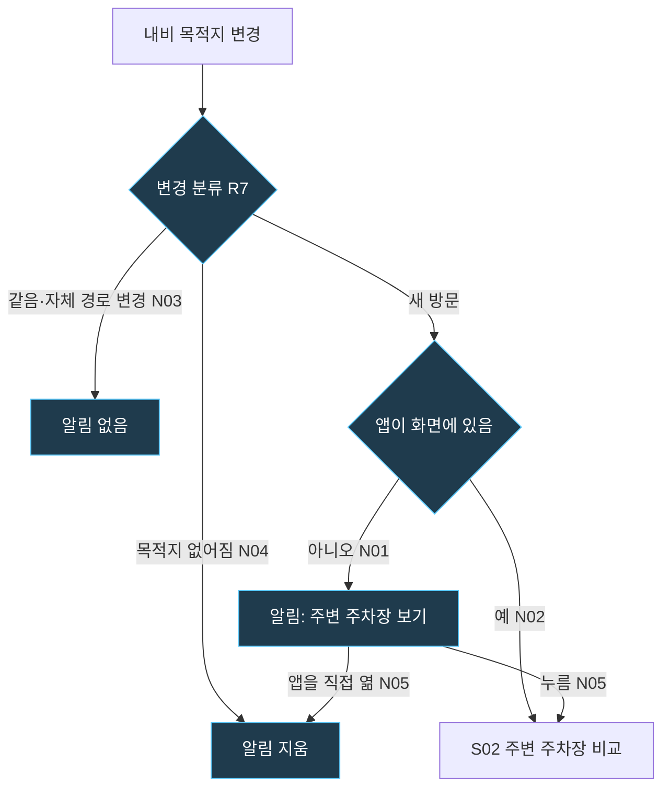

# 목적지 알림 스펙

내비에서 목적지를 정하고 안내를 시작했을 때 이 앱이 화면에 없으면, 알림으로 "주변 주차장 보기"를 띄우고 누르면 앱이 열린다. 앱이 내비 화면 위로 스스로 올라오는 방법은 없다(Android 10부터 백그라운드 화면 실행이 막혀 있고, NaviHelper에는 내비 화면을 띄우는 요청만 있다). 2026-11-12 사용자 결정: 세 방법(분할 화면 전제, 알림, 음성) 가운데 알림으로 간다.

주차장 조회 자체는 바뀌지 않는다. 목적지가 바뀌면 앱은 화면에 없어도 [주차장 안내 스펙](parking-guidance.md) R7대로 주차장 조회를 시작하고 화면을 S02로 바꿔 둔다. 이 스펙은 그 사실을 사용자에게 알리는 한 줄만 더한다. [목적지 직접 검색](destination-search.md)으로 내비 검색 화면에 나가 있다가 장소를 고른 경우에도 같은 알림이 온다.

`[가설]`은 사람이 확인하기 전인 줄이다. 사용자가 "진행해"라고 해서 가설대로 구현했다.

## 무엇이 되면 끝인가

앱이 화면에 없을 때 내비 목적지가 새 방문으로 바뀌면 알림이 하나 뜨고, 그 알림을 누르면 앱이 S02(주변 주차장 비교)로 열린다.

## N1. 알림

| 상황 | 결과 |
|---|---|
| 앱이 화면에 없음, 내비 목적지가 새 방문으로 바뀜 | 알림 "서림문화센터 주변 주차장 보기" / "눌러서 주차장을 확인하세요" `[가설: 문구]` |
| 앱이 화면에 있음(분할 화면 포함), 새 방문 | 알림 없음. 화면이 S02로 바뀐다 |
| 같은 목적지가 다시 통지됨 | 알림 없음 |
| 앱 자신의 경로 변경(예정 입구 30m 이내, R7) | 알림 없음 |
| 목적지가 없어짐(안내 취소 등) | 떠 있는 알림을 지운다 |
| 알림이 떠 있는데 새 방문이 또 옴 | 알림을 쌓지 않고 하나를 새 목적지로 바꾼다 |
| 알림을 누름 | 앱이 앞으로 온다. 화면은 S02(조회 중이거나 끝난 상태, 후보가 없으면 S07), 알림은 사라진다 |
| 알림을 두고 앱을 직접 엶 | 알림을 지운다 |
| 목적지 이름이 빈 값 | "목적지 주변 주차장 보기" `[가설]` |
| 알림 권한 없음(Android 13 이상) | 알림 없음, 앱 동작은 그대로. 권한은 앱을 열 때 묻고, 두 번 거절하면 시스템이 더 묻지 않는다 `[가설: 묻는 시점]` |
| 주행 중 | 정차 중과 같이 알림을 보낸다. 보여 줄지는 차량 OS가 정한다 `[가설]` |
| 앱 프로세스가 없거나 화면(Activity)이 종료됨 | 알림 없음. 내비 이벤트를 받는 곳이 없다(한계) |
| mock 빌드 | MOCK 띠의 "목적지 5초 뒤 설정"을 누르고 홈으로 나가면 같은 흐름 |

## 알림이 보이는 방식 `[가설]`

Android Automotive OS에서 시스템 권한이 없는 앱의 알림은 채널 중요도가 HIGH 이상이고 분류가 통화·메시지·내비게이션 가운데 하나일 때만 화면 위 카드(헤드업)로 뜬다. 그 밖의 알림은 소리 없이 알림 센터에만 쌓인다([Notifications on Android Automotive OS](https://developer.android.com/training/cars/notifications)).

그래서 채널 중요도 HIGH, 분류 `CATEGORY_NAVIGATION`으로 보낸다. 대가가 둘 있다. 내비게이션 분류 알림은 8초 뒤 사라지면 알림 센터에 남지 않고, 제조사가 이 분류의 헤드업을 꺼 둘 수 있다. 분류를 빼면 반대로 알림 센터에는 남지만 화면에 뜨지 않는다. Pleos Connect가 어느 쪽인지는 Pleos 에뮬레이터에서 확인하지 못했다.

## 흐름도

## ID 표

| ID | 테스트 표시 이름 | 갈래 설명 |
|---|---|---|
| N01 | AlertNewDestinationTest.앱이 화면에 없을 때 새 방문 목적지가 잡히면 알린다 | 기본 |
| N02 | AlertNewDestinationTest.앱이 화면에 있으면 알리지 않는다 | 화면이 이미 바뀐다 |
| N03 | AlertNewDestinationTest.같은 목적지나 앱 자신의 경로 변경에는 알리지 않는다 | R7 분류 |
| N04 | AlertNewDestinationTest.목적지가 없어지면 알림을 지운다 | 낡은 알림 |
| N05 | | 누르면 앱이 열리고, 앱이 화면에 오면 알림을 지운다 (Activity·ViewModel 배선, 단위 테스트 없음, 에뮬레이터로 확인) |
| N06 | | 알림 모양·분류·권한 요청 (어댑터·Activity, 단위 테스트 없음, 에뮬레이터로 확인) |

## 빈칸 (사람이 정할 것)

- 문구 둘("○○ 주변 주차장 보기", "눌러서 주차장을 확인하세요")과 이름이 없을 때의 "목적지 주변 주차장 보기".
- 알림 분류. 지금은 화면에 뜨는 쪽(`CATEGORY_NAVIGATION`)이다. 길 안내용 분류를 주차장 제안에 쓰는 것이 심사에서 문제가 되는지는 모른다.
- 알림을 보내는 시점. 2026-11-12 Pleos 에뮬레이터 로그로 확인: "안내 시작"을 누르면 `onRouteStarted`·`onRouteEnded`가 오고 `onDestinationChanged`는 오지 않는다. 그래서 앱은 경로 탐색 이벤트 뒤에 목적지를 다시 묻고, 그 답이 새 방문이면 알린다([주차장 안내 스펙](parking-guidance.md) R7 아래 이벤트 표). 경로 미리보기 단계에서 먼저 오는 이벤트가 있는지는 아직 모른다.
- 알림 권한을 묻는 시점. 지금은 앱을 열 때다.
- 주행 중에도 보낼지. 지금은 보낸다.
- 화면(Activity)이 종료된 뒤에도 알릴지. 하려면 프로세스 단위로 목적지를 듣는 상주 서비스가 필요하다. 지금은 하지 않는다.
