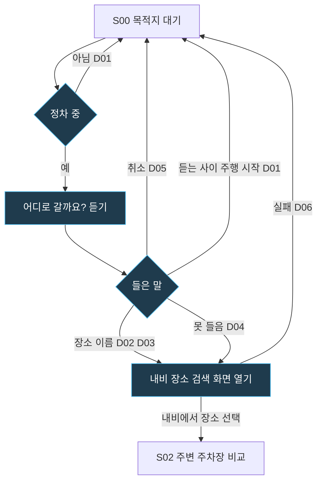

# 목적지 직접 검색 스펙

S00(목적지 대기)의 "목적지 직접 검색"이다. 기획서 시안 S00에는 "정차 중에는 목적지를 직접 검색할 수도 있습니다." 문구와 버튼이 있다. 방문 목적지는 앱이 정하지 않고 내비에서 가져온다는 규칙([주차장 안내 스펙](parking-guidance.md) R7·T01)은 그대로다.

2026-11-09 사용자 결정 세 가지는 확정이다. ① 앱 안에 검색 결과 목록을 두지 않고 내비의 장소 검색 화면을 연다(NaviHelper `requestNavigationScreen(NavigationScreenRequest.SearchPlace(keyword))`, SDK 3.0.5 소스로 확인, 권한 `pleos.car.permission.NAVI_CUSTOM_MAP`). ② 키워드는 버튼을 누른 뒤 음성으로 받는다. ③ S00에만 둔다. S02의 "음성으로 선택"은 지금처럼 목록 명령만 받는다. `[가설]`은 사람이 확인하기 전인 줄이다.

## 무엇이 되면 끝인가

목적지가 없을 때 정차 중이면 S00의 "목적지 직접 검색"을 눌러 장소 이름을 말하고, 그 이름으로 내비 장소 검색 화면이 열린다. 내비에서 장소를 고르면 내비 목적지가 바뀌고, 앱은 기존 흐름대로 S02로 간다.

## D1. 검색 열기

| 상황 | 결과 |
|---|---|
| S00, 정차 중 | 버튼 활성 |
| S00, 주행 중 또는 주행 상태 모름 | 버튼 비활성, "정차 중에만 검색할 수 있어요" `[가설: 문구]` (R9) |
| 버튼 누름 | "어디로 갈까요?"라고 묻고 한 번 듣는다 `[가설: 문구]` |
| 들은 말 "강남역" | "강남역"으로 내비 장소 검색을 연다 |
| "강남역 찾아줘"·"서울역으로 가줘"·"롯데월드 타워 검색해줘." | 끝의 요청 말과 문장 부호를 떼고 연다("강남역", "서울역", "롯데월드 타워") `[가설: 뗄 말 목록]` |
| 못 들음(무음 10초)·빈 말·요청 말만 있음, 음성 엔진 실패 | 빈 키워드로 검색 화면을 연다. 입력은 내비에서 (음성 엔진 실패도 못 들은 것으로 본다 `[가설]`) |
| "취소"·"그만"·"음성 종료" | 열지 않는다. S00 그대로 |
| 듣는 사이 주행이 시작됨 | 열지 않는다 (R9) |
| 듣는 중 화면 터치 | 듣기를 멈추고 늦은 인식 결과는 버린다 (R10 T06과 같음) |
| 내비 검색 화면을 열지 못함 | S00에 "내비 검색 화면을 열지 못했어요" `[가설: 문구]` |
| 열었음 | S00에 "내비에서 장소를 고르면 이 화면이 바뀝니다" `[가설: 문구]` |
| 내비에서 장소를 골라 목적지가 바뀜 | 기존 목적지 흐름 → S02 |
| mock 빌드 | 내비가 없으니 MOCK 띠에 "내비 검색(가상): <키워드>"를 보인다. 목적지는 띠의 "내비 목적지 있음"으로 바꾼다 |

## 흐름도

## ID 표

| ID | 테스트 표시 이름 | 갈래 설명 |
|---|---|---|
| D01 | OpenDestinationSearchTest.주행 중이거나 주행 상태를 모르면 열지 않는다 | 정차 중에만 |
| D02 | OpenDestinationSearchTest.들은 장소 이름으로 내비 장소 검색을 연다 | 기본 |
| D03 | OpenDestinationSearchTest.끝의 요청 말과 문장 부호는 떼고 연다 | 키워드 다듬기 |
| D04 | OpenDestinationSearchTest.못 들었거나 요청 말만 있으면 빈 키워드로 연다 | 입력은 내비에서 |
| D05 | OpenDestinationSearchTest.취소라고 하면 열지 않는다 | 취소 |
| D06 | OpenDestinationSearchTest.내비가 검색 화면을 못 열면 NavigationFailed | 실패 |
| D07 | | 버튼·문구·터치 중단은 ViewModel·화면 (단위 테스트 없음, S00 화면 대조와 에뮬레이터로 확인) |

## 빈칸 (사람이 정할 것)

- 문구 넷("정차 중에만 검색할 수 있어요", "어디로 갈까요?", "내비 검색 화면을 열지 못했어요", "내비에서 장소를 고르면 이 화면이 바뀝니다").
- 뗄 요청 말 목록(찾아줘·검색해줘·가줘·가자·안내해줘와 그 앞의 "으로/로").
- 못 들었을 때 빈 검색 화면을 열지, 아무것도 하지 않을지. 지금은 연다.
