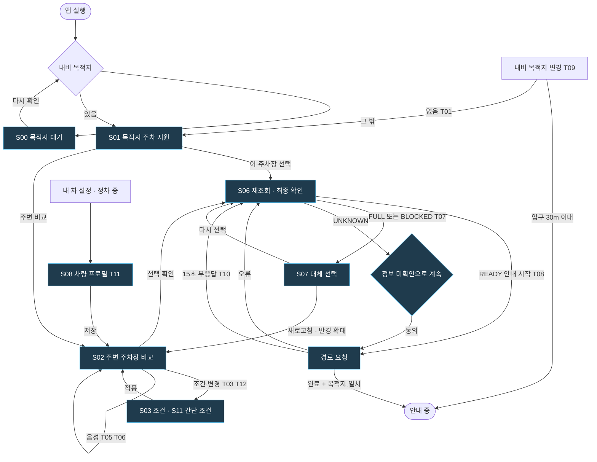

# 주차장 안내 스펙

기획서 「주차까지 차량용 앱 화면 시안 기획서」(2026-11-01 검토본) 14~30절의 규칙과 T01~T16 검수 시나리오를 예시 표로 옮긴 것이다. `[가설]`은 기획서에 값이 없거나 두 해석이 가능해 에이전트가 채운 줄이다. 사람이 확인하기 전에는 확정이 아니다. 값을 바꾸면 이 표와 `usecase` 모듈 테스트를 같은 커밋에서 고친다.

이 파일은 WORK 볼트 규칙(§3.2)대로라면 허브 옆에 두어야 한다. 허브가 아직 없어 형제 저장소(dropByExhibit)의 선례를 따라 저장소에 두었다. 허브를 만들면 옮기거나 링크한다.

## 무엇이 되면 끝인가

내비 목적지를 가져와 목적지에 연결된 주차장과 주변 주차장을 차량 조건·잔여 대수·거리·요금으로 비교하고, 운전자가 고른 주차장을 최신 정보로 다시 확인한 뒤 차량 도착지를 그 주차장 입구로 바꾼다. 방문 목적지는 앱이 유지한다.

## 지금 코드와 기획서의 차이 (의도한 축소)

- 서버(v1 API)가 없어 규칙을 전부 클라이언트(usecase)가 계산한다. 서버가 생기면 같은 규칙을 옮기고 클라이언트는 표시만 한다 `[가설]`.
- 주차장 데이터는 기획서 24절의 가상 데이터(`data:parking`)다. 공공 API 연결은 다음 작업.
- 화면 S04(상세)·S09(출처)·S10(키패드 — S08에 숫자 입력으로 대신)·S12(사전 조건 확인 — S03으로 대신)·S13·S14(제보)와 S00의 직접 검색은 아직 없다.
- FusedLocation(현재 위치)은 쓰지 않는다. 검색 중심은 방문 목적지이고 거리도 목적지 기준이라 아직 필요한 화면이 없다.
- 시안과 다르게 확정한 표현(2026-11-08 화면 검증 full, 사람 판정): S01은 운영 시간 밖·차량 제한 일부 미확인 경고 줄을 조건부로 추가 표시한다. S02 필터 칩은 '차량 제한 위반 제외', 카드에는 주차 방식만 쓰고 시설 유형은 선택 상세 카드에만, 잔여 대수는 0대가 아니면 초록(적음 임계값 없음). S03은 칩 대신 라벨+토글이고 '방식 미확인 포함' 기본값은 켜짐, 카드 캡션 '터치 또는 음성으로 변경'은 넣지 않는다. S07 대체 카드는 '잔여 대수 정보 없음'으로 쓰고 '현장 확인 필요'는 넣지 않는다.
- S02 개념 지도와 S05 음성 전용 화면(현재 조건 카드·인식 문장·파형)은 아직 없다. 지금은 지도 자리에 안내·상세 카드, 음성은 S02 위 배너다. 둘 다 다음 작업.

## R1. 차량 제한 판정 (기획서 20절, T04·T16)

| 상황 | 결과 |
|---|---|
| 차량 높이 2100, 제한 "2100 이하" | 충족 |
| 차량 높이 2100, 제한 "2100 미만" | BLOCKED |
| 차량 높이 2101, 제한 2100 이하 | BLOCKED |
| 차량 높이를 모름 | UNKNOWN (HEIGHT_MM_UNKNOWN) |
| 중량 제한 기준 GROSS, 차량 중량 기준 CURB | UNKNOWN (기준 불일치) |
| 중량 기준이 같음 | 값 비교 |
| 폭 제한이 미러 포함 기준, 차량 폭은 미러 제외 | UNKNOWN |
| 제한 확인일 31일 경과 | UNKNOWN (만료) |
| 제한 확인일 30일 경과 | 아직 유효 |
| 제한 확인일 없음 | UNKNOWN `[가설]` |
| 출처 간 값 상충 | UNKNOWN |
| SUV 불가 + 차종 SUV | BLOCKED |
| SUV 불가 + 차종 미확인 | UNKNOWN |
| SUV 불가 + 차종 기타 | 충족 |
| 한 항목 BLOCKED, 다른 항목 상충 | BLOCKED (BLOCKED 우선) |
| 제한 정보가 하나도 없음 | UNKNOWN (NO_RESTRICTION_DATA) `[가설]` — "입차 가능" 배지를 쓰지 않기 위해 |
| 모든 제한 확인·충족 | VERIFIED_MATCH |

## R2. 검색 범위와 페이지 (기획서 15·19절, T02)

| 상황 | 결과 |
|---|---|
| 검색 중심 | 방문 목적지. 현재 차량 위치를 쓰지 않는다 |
| 첫 반경 | 직선 500m |
| 후보 없음 → 사용자가 넓히기 | 1000m, 다음 2000m, 그 다음은 없음 |
| 반경 안 시설 | 후보. 목적지와 검증된 관계가 있으면 관계를 붙인다 |
| 연결 주차장이 반경 밖 | S01에는 보이고 S02 후보에는 없음 |
| 첫 조회 결과 | 자동 선택 없음. 카드 터치나 음성 번호로 고른다 |
| 후보 4개 | 첫 페이지 3개, 둘째 1개. 번호는 페이지 기준 |
| 페이지 이동 | 선택·최종 확인 초기화 |
| 최대 후보 | 30개 |
| 거리 | 보행 경로 공급자가 없어 직선 거리. 도보 시간으로 환산하지 않음 |

## R3. 제외 순서와 정렬 (기획서 16·19절, T03)

제외는 이 순서다. ① 확인된 제한 위반(BLOCKED, 사용자가 풀 수 없음) ② 운영 시간 충돌(도착~출차가 운영 시간 밖) ③ 신선한 만차(0대이고 LIVE·RECEIVED) ④ 사용자 필터.

| 상황 | 결과 |
|---|---|
| 기계식 제외 켬 + 방식 미확인 포함 켬 | SELF·UNKNOWN 남고 MECHANICAL 빠짐 |
| 기계식 제외 끔, BLOCKED 시설 | 그래도 빠짐 |
| MIXED, 기계식 제외 켬 | 자주식 구역 별도 입구·조건 확인(`selfZoneVerified`)이 있을 때만 남음 |
| 방식 미확인 포함 끔 | UNKNOWN 방식 빠짐 |
| 잔여 미제공 포함 끔 | UNAVAILABLE·ERROR 빠짐 `[가설]` (STALE은 남음) |
| 신선한 0대 | 빠짐 |
| 오래된 0대(STALE) | 남고 STALE 표시 |
| 운영 시간 불명 | 남고 경고 |
| 정렬 DISTANCE | 거리 오름차순, null 마지막 |
| 정렬 COST | 요금 오름차순, 산출 불가 마지막 |
| 정렬 AVAILABILITY | 잔여 내림차순, 미제공 마지막 |
| 동점 | 거리 → parkingId 사전순 |

## R4. 잔여 대수 상태 (기획서 24절, T13)

| 상황 | 결과 |
|---|---|
| 원본 갱신 시각 있음, 5분 이내 | LIVE |
| 원본 갱신 시각 있음, 5분 초과 | STALE |
| 원본 없음, 수신 2분 이내 | RECEIVED ("원본 갱신 시각 미제공" 계속 표시) |
| 원본 없음, 수신 2분 초과 | STALE |
| 출처가 정보를 주지 않음 | UNAVAILABLE. 0대로 처리하지 않음 |
| 잔여 대수 필드 null | UNAVAILABLE |
| 이번 조회 실패 | ERROR. 이전 값은 덮어쓰지 않음 |

## R5. 요금 (기획서 19절, T14)

`기본료 + ceil(max(0, 분 − 기본분) / 추가단위분) × 추가료`, 일 최대 요금이 있으면 그 이하.

| 상황 | 결과 |
|---|---|
| 기본 30분 1,500, 추가 10분 500, 60분 | 3,000원 |
| 31분 | 2,000원 |
| 30분 | 1,500원 |
| 0분 | 1,500원 `[가설]` |
| 일 최대 5,000, 300분 | 5,000원 |
| 요금제 미확인 | 산출 불가 |
| 시작~종료가 날짜를 넘음 | 산출 불가 (일자 경계 미지원) |
| 기본 120분 0원 | 0원 = 무료 |
| 할인 | 기본 미적용 |

## R6. 시간 (기획서 19절)

| 상황 | 결과 |
|---|---|
| 시작 시각 | 내비 도착 예정 시각(지금 + remainTime초). 없으면 지금 |
| 종료 시각 | 시작 + 예상 주차 시간(기본 60분, 30·60·120·180·240 선택) |
| 운영 시간 안 | OPEN |
| 종료 전에 운영이 끝남 | CLOSED → 제외 |
| 운영 시간 모름 | UNKNOWN → 경고만 |

## R7. 최종 확인·경로 요청·목적지 변경 (기획서 17·25절, T07~T10)

| 상황 | 결과 |
|---|---|
| S06 진입 | 즉시 재조회. 끝나기 전엔 안내 버튼 비활성 |
| 재조회: 차량 제한 BLOCKED | S07 (BLOCKED), requestRoute 0회 |
| 재조회: 신선한 0대 | S07 (FULL), requestRoute 0회 |
| 재조회: LIVE·RECEIVED, 잔여 > 0 | READY, 30초 유효 |
| 재조회: STALE·UNAVAILABLE·ERROR | UNKNOWN. "정보 미확인으로 계속"에 동의해야 READY처럼 동작. 제한 위반 우회는 불가 |
| READY에서 화면·음성 동시 확인 | requestRoute 정확히 1회 |
| 30초 만료 뒤 확인 | 재조회부터 |
| 경로 요청 완료 이벤트 + 내비 목적지가 입구 30m 이내 | SUCCESS |
| 내비 오류 | FAILED, 선택 보존 |
| 15초 무응답 | UNKNOWN, 목적지 재조회, 자동 재전송 없음 |
| 내비 목적지 변경: 예정 입구 30m 이내 | 자체 경로 변경 → 방문 목적지 유지 |
| 내비 목적지 변경: 그 밖 | 새 방문 → 후보·선택·확인 초기화, S01부터 |
| 내비 목적지 제거 | 새 방문(초기화), S00 |
| 늦게 온 조회 응답 | 버전이 다르면 버림 |

## R8. 차량 프로필 입력 (기획서 18절, T11)

| 항목 | 허용 | 그 밖 |
|---|---|---|
| 높이 mm | 500~5000 정수 | 0·5001 오류, 빈 값 미확인(null) |
| 폭 mm | 500~3000 | 미러 제외 기준 |
| 길이 mm | 1000~12000 | |
| 중량 kg | 200~10000 | |
| 소수·부호 | 오류 "숫자만 입력하세요" | |
| 저장 | version +1, 후보·최종 확인 무효화 후 재조회 | |
| 초기화 | 사용자 입력만 지움 | |
| 주행 전환 중 편집 | 초안은 메모리에, 화면은 닫힘 | |

## R9. 주행 상태와 허용 조작 (기획서 26절, T12)

| 상황 | 결과 |
|---|---|
| 플랫폼 규제 콜백: DO 필요 | MOVING |
| 플랫폼 규제 콜백: 규제 없음 | PARKED |
| 차량 서비스 없음(폰) | UNKNOWN. 정차로 간주하지 않음 |
| UNKNOWN | 조회 읽기만. 버튼 잠금 |
| MOVING에서 S03 편집 중 | 초안 폐기 후 S02. S03은 S11(스위치 셋)로 |
| MOVING에서 S08 | 닫고 S02, 초안 보존 |
| 내 차 설정 | PARKED에서만 열림 |
| mock 플레이버 | 패널로 상태 전환 가능. pleos에는 스위치 없음 |

## R10. 음성 명령 (기획서 26절, T05·T06)

| 들은 말 | 해석 |
|---|---|
| "기계식 빼줘" / "기계식 포함해줘" | 기계식 제외 켬 / 끔 |
| "잔여 정보 없는 곳 제외/포함" | 잔여 미제공 포함 끔 / 켬 |
| "첫 번째"·"두 번째"·"세 번째"·"2번" | 보이는 3개 중 선택 → 바로 S06 재조회 `[가설]` |
| "네 번째", 보이는 수보다 큰 번호 | 불분명 |
| "거리순"·"요금순"·"여유 공간순" | 정렬 |
| "다음 페이지"·"이전 페이지" | 페이지 이동 |
| "안내 시작" | S06 READY에서만 경로 요청 |
| "예" | 불분명 — 예만으로 경로를 보내지 않음 |
| "취소"·"그만"·"음성 종료" | 종료 |
| "기계식 빼고 두 번째" | 필터만 적용하고 새 목록에서 재선택 요청 |
| 불분명 | 재질문 1회 후 종료 |
| 듣는 중 터치 | 터치 먼저, 늦은 인식 결과 폐기 |
| 무음 | 10초 뒤 null → 불분명 `[가설]` (기획: 무음 5초·발화 10초·처리 5초). mock·pleos 어댑터 모두 10초 |

## 흐름도

이번 작업이 처음 만드는 갈래라 전부 `changed`다.

## ID 표

| ID | 테스트 표시 이름 | 갈래 설명 |
|---|---|---|
| T01 | | 목적지 없음 → S00. 위치만으로 목적지 자동 확정 없음. (ViewModel 흐름, 단위 테스트 없음) |
| T02 | PagingTest.후보 4개면 첫 페이지 3개 둘째 페이지 1개 | 3개씩 페이지, 번호는 페이지 기준 |
| T03 | SelectCandidatesTest.기계식 제외 켜고 방식 미확인 포함이면 자주식과 미확인만 남는다 · 기계식 제외를 꺼도 BLOCKED는 남지 않는다 | 필터 조합 |
| T04 | EligibilityTest.높이 2100에 제한 2100 이하면 충족 · 높이 2100에 제한 2100 미만이면 BLOCKED · 중량 기준이 다르면 UNKNOWN | 높이 경계 |
| T05 | VoiceCommandTest.기계식 빼고 두 번째는 필터만 적용한다 | 복합 발화 |
| T06 | | 음성 중 터치 → 늦은 결과 폐기 (ViewModel, 단위 테스트 없음) |
| T07 | RecheckTest.신선한 0대면 FULL | 재조회 만차 → S07, requestRoute 0회 |
| T08 | RecheckTest.LIVE 잔여가 있으면 READY이고 30초 뒤 만료 | 중복 안내 차단·만료는 ViewModel (단위 테스트 없음) |
| T09 | DestinationChangeTest.입구에서 31m면 새 방문 | 응답 순서 역전은 ViewModel 버전 검사 (단위 테스트 없음) |
| T10 | | 경로 결과 15초 미수신 → UNKNOWN (data:navi, 에뮬레이터 검증) |
| T11 | VehicleValidationTest.높이 0은 오류 · 높이 5001은 오류 · 빈 값은 미확인 | 차량 값 입력 |
| T12 | | 주행 전환 중 편집 폐기 (ViewModel, 단위 테스트 없음) |
| T13 | AvailabilityTest.원본 시각 6분 전이면 STALE · 원본 없이 수신 3분이면 STALE | 오래된 잔여 |
| T14 | FeeTest.기본 30분 1500원 추가 10분 500원에 60분이면 3000원 · 31분이면 2000원 · 요금제가 없으면 산출 불가 | 요금 |
| T15 | SearchParkingTest.거리는 목적지에서 직선이다 | 보행 경로 미지원 → 직선 거리, 도보 분 표시 없음 |
| T16 | EligibilityTest.확인 31일 지난 제한은 UNKNOWN · 출처가 상충하는 제한은 UNKNOWN | 근거 만료·상충 |

## 빈칸 (사람이 정할 것)

- 제한 정보가 전혀 없는 시설을 UNKNOWN으로 둘지(지금), 아니면 "제한 없음"으로 보여 줄지.
- MIXED 시설의 `selfZoneVerified`를 어느 데이터에서 채울지. 공공 데이터에 그런 필드가 없으면 전부 제외된다.
- 음성 선택이 바로 S06 재조회로 가도 되는지, 선택만 하고 "확인"을 따로 받을지.
- 무음 5초·발화 10초·처리 5초를 SDK 설정으로 걸 수 있는지. 지금은 10초 한 번이다.
- 경로 요청의 `poiId`를 빈 문자열로 보내도 내비가 받아 주는지(사무국 질문과 같음).
- 서버가 생기면 규칙을 서버로 옮길지, 클라이언트에 둔 채 서버는 데이터만 줄지.
