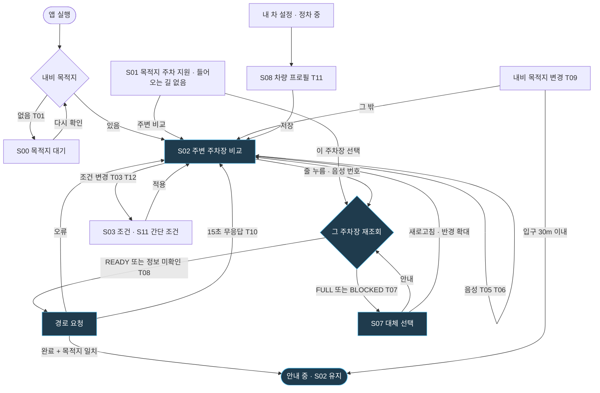

# 주차장 안내 스펙

기획서 「주차까지 차량용 앱 화면 시안 기획서」(2026-11-01 검토본) 14~30절의 규칙과 T01~T16 검수 시나리오를 예시 표로 옮긴 것이다. `[가설]`은 기획서에 값이 없거나 두 해석이 가능해 에이전트가 채운 줄이다. 사람이 확인하기 전에는 확정이 아니다. 값을 바꾸면 이 표와 `usecase` 모듈 테스트를 같은 커밋에서 고친다.

이 파일은 WORK 볼트 규칙(§3.2)대로라면 허브 옆에 두어야 한다. 허브가 아직 없어 형제 저장소(dropByExhibit)의 선례를 따라 저장소에 두었다. 허브를 만들면 옮기거나 링크한다.

## 무엇이 되면 끝인가

내비 목적지를 가져와 목적지에 연결된 주차장과 주변 주차장을 차량 조건·잔여 대수·거리·요금으로 비교하고, 운전자가 고른 주차장을 최신 정보로 다시 확인한 뒤 차량 도착지를 그 주차장 입구로 바꾼다. 방문 목적지는 앱이 유지한다.

## 지금 코드와 기획서의 차이 (의도한 축소)

- 서버(v1 API)가 없어 규칙을 전부 클라이언트(usecase)가 계산한다. 서버가 생기면 같은 규칙을 옮기고 클라이언트는 표시만 한다 `[가설]`.
- 주차장 데이터는 기획서 24절의 가상 데이터(`data:parking`)다. 공공 API 연결은 다음 작업.
- 화면 S04(상세)·S09(출처)·S10(키패드 — S08에 숫자 입력으로 대신)·S12(사전 조건 확인 — S03으로 대신)·S14는 아직 없다. S13 제보는 2026-11-14에 혼잡도 선택으로 넣었고 S02 표에 혼잡도 열이 생겼다([혼잡도 제보 스펙](congestion-report.md)). S00의 직접 검색은 2026-11-09에 넣었다([목적지 직접 검색 스펙](destination-search.md)).
- FusedLocation(현재 위치)은 쓰지 않는다. 검색 중심은 방문 목적지이고 거리도 목적지 기준이라 아직 필요한 화면이 없다.
- 시안과 다르게 확정한 표현(2026-11-08 화면 검증 full, 사람 판정): S01은 운영 시간 밖·차량 제한 일부 미확인 경고 줄을 조건부로 추가 표시한다. S02 필터 칩은 '차량 제한 위반 제외', 카드에는 주차 방식만 쓰고 시설 유형은 선택 상세 카드에만, 잔여 대수는 0대가 아니면 초록(적음 임계값 없음). S03은 칩 대신 라벨+토글이고 '방식 미확인 포함' 기본값은 켜짐, 카드 캡션 '터치 또는 음성으로 변경'은 넣지 않는다. S07 대체 카드는 '잔여 대수 정보 없음'으로 쓰고 '현장 확인 필요'는 넣지 않는다.
- 내비 목적지가 새 방문으로 바뀌면 시안의 S01 대신 S02 비교부터 연다(2026-11-12 사용자 결정). S01 화면 코드는 남아 있지만 지금은 들어오는 버튼이 없다.
- 2026-11-12 디자인 검증(/impeccable critique 20/40) 뒤 사용자 결정으로 시안에서 벗어난 것: S06 최종 확인과 "정보 미확인으로 계속"을 없앴다(R7). S02는 오른쪽 안내·상세 카드를 없애고 번호·주차장·남은 자리·직선 거리·요금·안내 열로 된 표로 바꿨다. 시설 유형(노상·노외)은 상세 카드와 함께 화면에서 빠졌다. 남은 자리를 모르면 S02·S07 모두 "정보 미확인"으로 쓴다(11-08의 S07 "잔여 대수 정보 없음"을 바꿈). "차량 제한 일부 미확인"은 "차량 제한 미확인"으로 줄였다. 정렬은 순환 버튼 대신 세 칸 선택, S03 토글은 Material 스위치, 화면 ID·규칙 설명 문장(예: "S00 · …", "개념 지도 없음")과 앱 시계는 화면에서 뺐다.
- S02 개념 지도와 S05 음성 전용 화면(현재 조건 카드·인식 문장·파형)은 아직 없다. 지금은 지도 자리에 안내·상세 카드, 음성은 S02 위 배너다. 둘 다 다음 작업.

## R1. 차량 제한 판정 (기획서 20절, T04·T16)

| 상황 | 결과 |
|---|---|
| 차량 높이 2100, 제한 "2100 이하" | 충족 |
| 차량 높이 2100, 제한 "2100 미만" | BLOCKED |
| 차량 높이 2101, 제한 2100 이하 | BLOCKED |
| 차량 높이를 모름 | UNKNOWN (HEIGHT_MM_UNKNOWN) |
| 중량 제한 기준 GROSS, 차량 중량 기준 CURB | UNKNOWN (기준 불일치) |
| 중량 기준이 같음 | 값 비교 |
| 폭 제한이 미러 포함 기준, 차량 폭은 미러 제외 | UNKNOWN |
| 제한 확인일 31일 경과 | UNKNOWN (만료) |
| 제한 확인일 30일 경과 | 아직 유효 |
| 제한 확인일 없음 | UNKNOWN `[가설]` |
| 출처 간 값 상충 | UNKNOWN |
| SUV 불가 + 차종 SUV | BLOCKED |
| SUV 불가 + 차종 미확인 | UNKNOWN |
| SUV 불가 + 차종 기타 | 충족 |
| 한 항목 BLOCKED, 다른 항목 상충 | BLOCKED (BLOCKED 우선) |
| 제한 정보가 하나도 없음 | UNKNOWN (NO_RESTRICTION_DATA) `[가설]` — "입차 가능" 배지를 쓰지 않기 위해 |
| 모든 제한 확인·충족 | VERIFIED_MATCH |

## R2. 검색 범위와 페이지 (기획서 15·19절, T02)

| 상황 | 결과 |
|---|---|
| 검색 중심 | 방문 목적지. 현재 차량 위치를 쓰지 않는다 |
| 첫 반경 | 직선 500m |
| 후보 없음 → 사용자가 넓히기 | 1000m, 다음 2000m, 그 다음은 없음 |
| 반경 안 시설 | 후보. 목적지와 검증된 관계가 있으면 관계를 붙인다 |
| 연결 주차장이 반경 밖 | S02 후보에 없다. S01로 가는 길이 없어 어디에도 보이지 않는다 `[가설: 그대로 둘지]` |
| 첫 조회 결과 | 자동 안내 없음. 줄을 누르거나 음성 번호로 바로 안내한다(R7) |
| 후보 6개 | 첫 페이지 5개, 둘째 1개. 번호는 페이지 기준 (2026-11-14 사용자 결정, 그 전에는 한 페이지 3개) |
| 페이지 이동 | 번호만 바뀐다. 진행 중인 확인·요청·안내는 그대로 |
| 최대 후보 | 30개 |
| 거리 | 보행 경로 공급자가 없어 직선 거리. 도보 시간으로 환산하지 않음 |

## R3. 제외 순서와 정렬 (기획서 16·19절, T03)

제외는 이 순서다. ① 확인된 제한 위반(BLOCKED, 사용자가 풀 수 없음) ② 운영 시간 충돌(도착~출차가 운영 시간 밖) ③ 신선한 만차(0대이고 LIVE·RECEIVED) ④ 사용자 필터.

| 상황 | 결과 |
|---|---|
| 기계식 제외 켬 + 방식 미확인 포함 켬 | SELF·UNKNOWN 남고 MECHANICAL 빠짐 |
| 기계식 제외 끔, BLOCKED 시설 | 그래도 빠짐 |
| MIXED, 기계식 제외 켬 | 자주식 구역 별도 입구·조건 확인(`selfZoneVerified`)이 있을 때만 남음 |
| 방식 미확인 포함 끔 | UNKNOWN 방식 빠짐 |
| 잔여 미제공 포함 끔 | UNAVAILABLE·ERROR 빠짐 `[가설]` (STALE은 남음) |
| 신선한 0대 | 빠짐 |
| 오래된 0대(STALE) | 남고 STALE 표시 |
| 운영 시간 불명 | 남고 경고 |
| 정렬 DISTANCE | 거리 오름차순, null 마지막 |
| 정렬 COST | 요금 오름차순, 산출 불가 마지막 |
| 정렬 AVAILABILITY | 잔여 내림차순, 미제공 마지막 |
| 동점 | 거리 → parkingId 사전순 |

## R4. 잔여 대수 상태 (기획서 24절, T13)

| 상황 | 결과 |
|---|---|
| 원본 갱신 시각 있음, 5분 이내 | LIVE |
| 원본 갱신 시각 있음, 5분 초과 | STALE |
| 원본 없음, 수신 2분 이내 | RECEIVED ("원본 갱신 시각 미제공" 계속 표시) |
| 원본 없음, 수신 2분 초과 | STALE |
| 출처가 정보를 주지 않음 | UNAVAILABLE. 0대로 처리하지 않음 |
| 잔여 대수 필드 null | UNAVAILABLE |
| 이번 조회 실패 | ERROR. 이전 값은 덮어쓰지 않음 |

## R5. 요금 (기획서 19절, T14)

`기본료 + ceil(max(0, 분 − 기본분) / 추가단위분) × 추가료`, 일 최대 요금이 있으면 그 이하.

| 상황 | 결과 |
|---|---|
| 기본 30분 1,500, 추가 10분 500, 60분 | 3,000원 |
| 31분 | 2,000원 |
| 30분 | 1,500원 |
| 0분 | 1,500원 `[가설]` |
| 일 최대 5,000, 300분 | 5,000원 |
| 요금제 미확인 | 산출 불가 |
| 시작~종료가 날짜를 넘음 | 산출 불가 (일자 경계 미지원) |
| 기본 120분 0원 | 0원 = 무료 |
| 할인 | 기본 미적용 |

## R6. 시간 (기획서 19절)

| 상황 | 결과 |
|---|---|
| 시작 시각 | 내비 도착 예정 시각(지금 + remainTime초). 없으면 지금 |
| 종료 시각 | 시작 + 예상 주차 시간(기본 60분, 30·60·120·180·240 선택) |
| 운영 시간 안 | OPEN |
| 종료 전에 운영이 끝남 | CLOSED → 제외 |
| 운영 시간 모름 | UNKNOWN → 경고만 |

## R7. 재조회·경로 요청·목적지 변경 (기획서 17·25절, T07~T10)

2026-11-12 사용자 결정: 최종 확인 화면(S06)을 없앤다. S02의 주차장 줄을 누르거나 음성으로 번호를 말하면 그 주차장만 최신 정보로 다시 확인하고 바로 경로를 바꾼다. 정보 미확인은 따로 동의받지 않고 S02 줄에 "정보 미확인"으로 보인다.

| 상황 | 결과 |
|---|---|
| S02 줄 누름 · 음성 번호 · S07 "안내" | 그 주차장만 즉시 재조회. 그 줄에 "확인 중" |
| 재조회: 차량 제한 BLOCKED | S07 (BLOCKED), requestRoute 0회 |
| 재조회: 신선한 0대 | S07 (FULL), requestRoute 0회 |
| 재조회: LIVE·RECEIVED, 잔여 > 0 | 바로 requestRoute 1회 |
| 재조회: STALE·UNAVAILABLE·ERROR | 묻지 않고 requestRoute 1회. 그 줄은 이미 "정보 미확인"으로 보인다. 제한 위반 우회는 불가(BLOCKED가 먼저) |
| 확인 중·요청 중에 다른 줄 누름 · 같은 줄 다시 누름 | 무시. requestRoute 정확히 1회 |
| 안내 중인 상태에서 다른 줄 누름 | 그 주차장으로 다시 재조회·요청 |
| 경로 요청 중 | 그 줄에 "요청 중" `[가설: 문구]` |
| 경로 요청 완료 이벤트 + 내비 목적지가 입구 30m 이내 | SUCCESS. 그 줄에 "안내 중", 화면은 S02 그대로 `[가설]` |
| 내비 오류 | FAILED. 그 줄 아래에 이유 한 줄, 다시 누르면 재시도 |
| 15초 무응답 | UNKNOWN, 목적지 재조회, 자동 재전송 없음. 그 줄에 "결과 확인 못 함" |
| 정렬·조건 변경으로 목록을 다시 조회 | 안내 중이면 그 줄의 "안내 중"을 유지, 아니면 초기화 |
| 내비 목적지 변경: 예정 입구 30m 이내 | 자체 경로 변경 → 방문 목적지 유지 |
| 내비 목적지 변경: 그 밖 | 새 방문 → 후보·선택·확인 초기화, S02부터. 후보가 없으면 S07 (2026-11-12 사용자 결정) |
| 내비 목적지 제거 | 새 방문(초기화), S00. 그 줄이 "안내 중"이었으면 도착 후보로 기억하고 정차하면 혼잡도를 묻는다([혼잡도 제보 스펙](congestion-report.md) C1·C2) |
| 경로 요청 결과를 기다리는 중에 내비 목적지 제거 | 방문 목적지·후보·선택 유지. 내비가 새 경로를 잡으려고 이전 경로를 먼저 취소한 것이다 (2026-11-14 에뮬레이터 로그) |
| 경로 요청 결과를 기다리는 중에 같은 목적지가 다시 옴, 그 자리가 예정 입구 30m 이내 | 자체 경로 변경 → "안내 중". 방문 목적지가 곧 고른 주차장인 경우다 |
| 늦게 온 조회 응답 | 버전이 다르면 버림 |

내비 목적지가 바뀌었는지는 아래 이벤트가 온 뒤 목적지를 다시 물어(`getDestinationInfo` → `onDestinationInfo`) 받은 값으로만 판정한다. 받은 값이 (0, 0)이면 목적지 없음이다.

| NaviHelper 이벤트 | SDK 3.0.5 주석 | 앱 |
|---|---|---|
| `onRouteStarted` | 경로 탐색 시작 | 목적지를 다시 묻는다 |
| `onRouteEnded` (deprecated) | 경로 탐색 완료 | 목적지를 다시 묻는다. 안내 종료가 아니므로 목적지를 지우지 않는다 |
| `onDestinationChanged` | 도착하거나 목적지를 지움 | 목적지를 다시 묻는다 |
| `onRouteCancelled` | 안내 취소 | 목적지 없음. 앱이 보낸 경로 요청의 결과를 기다리는 중이면 방문을 지우지 않는다 |

2026-11-12 Pleos 에뮬레이터 로그: 내비에서 "안내 시작"을 누르면 `onRouteStarted`와 `onRouteEnded`가 같은 순간에 오고 `onDestinationChanged`는 오지 않는다. 앱이 `onRouteEnded`를 안내 종료로 읽어 목적지를 지웠기 때문에 S02 대신 S00이 떴다. 이 수정으로 바뀌지 않아야 할 동작은 다음과 같다.

- 내비에 목적지가 없으면 앱은 계속 S00을 보인다(T01).
- 내비에서 안내를 취소하면 앱은 계속 S00으로 간다.
- 같은 목적지가 다시 오면 앱은 화면과 선택을 그대로 둔다.
- 앱이 차량 도착지를 주차장 입구로 바꾸면 앱은 계속 방문 목적지를 유지한다. 바꾸기 전에는 이때 오는 `onRouteEnded`도 목적지를 지웠을 것이다(코드로 추론, 에뮬레이터 미확인).

2026-11-14 Pleos 에뮬레이터 로그: 앱이 `requestRoute`를 보내면 0.2초 안에 `onRouteCancelled`가 먼저 오고, 내비가 경로 미리보기를 띄운 뒤 5초 카운트다운이 끝나면 `onRouteStarted`·`onRouteEnded`가 온다. `onRoutingCompleted`는 오지 않는다. 앱이 그 `onRouteCancelled`를 안내 취소로 읽어 방문 목적지와 선택을 지웠고, 이어서 온 주차장 좌표를 새 방문으로 분류해 "<주차장> 주변 주차장 보기" 알림까지 띄웠다. 그래서 요청 결과를 기다리는 동안(요청 중)에는 목적지 없음 통지로 방문을 지우지 않는다. "안내 중" 표시는 완료 이벤트가 아니라 다시 물어 받은 목적지가 입구 30m 이내인 것으로 켠다. 수정 뒤 같은 에뮬레이터에서 줄을 누르면 내비 경로가 바뀌고, 앱으로 돌아오면 그 줄이 "안내 중"이며 알림이 뜨지 않는 것을 확인했다(방문 목적지와 주차장이 같은 자리인 경우로 확인, 167m 떨어진 경우는 수정 전 실행에서 경로 변경까지만 확인).

- 경로 미리보기에서 15초 넘게 머물면 그 줄은 "결과 확인 못 함"이 됐다가, 안내가 시작되면 "안내 중"으로 바뀐다 `[가설: 미확인]`.
- 경로 미리보기를 닫아 버리면 내비에는 목적지가 없는데 앱은 방문 목적지를 계속 보인다. 그 줄은 "결과 확인 못 함"으로 남는다 `[가설: 그대로 둘지]`.

## R8. 차량 프로필 입력 (기획서 18절, T11)

| 항목 | 허용 | 그 밖 |
|---|---|---|
| 높이 mm | 500~5000 정수 | 0·5001 오류, 빈 값 미확인(null) |
| 폭 mm | 500~3000 | 미러 제외 기준 |
| 길이 mm | 1000~12000 | |
| 중량 kg | 200~10000 | |
| 소수·부호 | 오류 "숫자만 입력하세요" | |
| 저장 | version +1, 후보·최종 확인 무효화 후 재조회 | |
| 초기화 | 사용자 입력만 지움 | |
| 주행 전환 중 편집 | 초안은 메모리에, 화면은 닫힘 | |

## R9. 주행 상태와 허용 조작 (기획서 26절, T12)

| 상황 | 결과 |
|---|---|
| 플랫폼 규제 콜백: DO 필요 | MOVING |
| 플랫폼 규제 콜백: 규제 없음 | PARKED |
| 차량 서비스 없음(폰) | UNKNOWN. 정차로 간주하지 않음 |
| UNKNOWN | 조회 읽기만. 버튼 잠금 |
| MOVING에서 S03 편집 중 | 초안 폐기 후 S02. S03은 S11(스위치 셋)로 |
| MOVING에서 S08 | 닫고 S02, 초안 보존 |
| 내 차 설정 | PARKED에서만 열림 |
| mock 플레이버 | 패널로 상태 전환 가능. pleos에는 스위치 없음 |

## R10. 음성 명령 (기획서 26절, T05·T06)

| 들은 말 | 해석 |
|---|---|
| "기계식 빼줘" / "기계식 포함해줘" | 기계식 제외 켬 / 끔 |
| "잔여 정보 없는 곳 제외/포함" | 잔여 미제공 포함 끔 / 켬 |
| "첫 번째"~"다섯 번째"·"2번"·"5번" | 보이는 줄(한 페이지 5개) 중 그 줄을 누른 것과 같다 → 재조회 후 바로 안내(R7, 2026-11-12 사용자 결정) |
| "여섯 번째", 보이는 수보다 큰 번호 | 불분명 |
| "거리순"·"요금순"·"여유 공간순" | 정렬 |
| "다음 페이지"·"이전 페이지" | 페이지 이동 |
| "안내 시작" | 경로를 보내지 않고 "번호로 말씀해 주세요"라고 답한다 `[가설]` |
| "예" | 불분명 — 예만으로 경로를 보내지 않음 |
| "취소"·"그만"·"음성 종료" | 종료 |
| "기계식 빼고 두 번째" | 필터만 적용하고 새 목록에서 재선택 요청 |
| 불분명 | 재질문 1회 후 종료 |
| 듣는 중 터치 | 터치 먼저, 늦은 인식 결과 폐기 |
| 무음 | 10초 뒤 null → 불분명 `[가설]` (기획: 무음 5초·발화 10초·처리 5초). mock·pleos 어댑터 모두 10초 |

## 흐름도

2026-11-12: S06과 "정보 미확인으로 계속" 갈래를 없애고, 줄 누름에서 재조회를 거쳐 바로 경로 요청으로 가는 갈래로 바꿨다(`changed`).

## ID 표

| ID | 테스트 표시 이름 | 갈래 설명 |
|---|---|---|
| T01 | | 목적지 없음 → S00. 위치만으로 목적지 자동 확정 없음. (ViewModel 흐름, 단위 테스트 없음) |
| T02 | PagingTest.후보 6개면 첫 페이지 5개 둘째 페이지 1개 | 5개씩 페이지, 번호는 페이지 기준 |
| T03 | SelectCandidatesTest.기계식 제외 켜고 방식 미확인 포함이면 자주식과 미확인만 남는다 · 기계식 제외를 꺼도 BLOCKED는 남지 않는다 | 필터 조합 |
| T04 | EligibilityTest.높이 2100에 제한 2100 이하면 충족 · 높이 2100에 제한 2100 미만이면 BLOCKED · 중량 기준이 다르면 UNKNOWN | 높이 경계 |
| T05 | VoiceCommandTest.기계식 빼고 두 번째는 필터만 적용한다 | 복합 발화 |
| T06 | | 음성 중 터치 → 늦은 결과 폐기 (ViewModel, 단위 테스트 없음) |
| T07 | RecheckTest.신선한 0대면 FULL | 재조회 만차 → S07, requestRoute 0회 |
| T08 | RecheckTest.LIVE 잔여가 있으면 READY이고 30초 뒤 만료 | READY·정보 미확인이면 바로 요청, 확인·요청 중 중복 누름 무시는 ViewModel (단위 테스트 없음). 30초 유효는 usecase에 남아 있지만 화면은 더 쓰지 않는다 |
| T09 | DestinationChangeTest.입구에서 31m면 새 방문 · 앱이 보낸 경로 요청을 기다리는 중에 목적지가 사라지면 방문을 유지한다 · 방문 목적지가 고른 주차장 자리면 요청 중에 다시 온 같은 목적지를 자체 경로 변경으로 본다 | 응답 순서 역전은 ViewModel 버전 검사 (단위 테스트 없음) |
| T10 | | 경로 결과 15초 미수신 → UNKNOWN (data:navi, 에뮬레이터 검증) |
| T11 | VehicleValidationTest.높이 0은 오류 · 높이 5001은 오류 · 빈 값은 미확인 | 차량 값 입력 |
| T12 | | 주행 전환 중 편집 폐기 (ViewModel, 단위 테스트 없음) |
| T13 | AvailabilityTest.원본 시각 6분 전이면 STALE · 원본 없이 수신 3분이면 STALE | 오래된 잔여 |
| T14 | FeeTest.기본 30분 1500원 추가 10분 500원에 60분이면 3000원 · 31분이면 2000원 · 요금제가 없으면 산출 불가 | 요금 |
| T15 | SearchParkingTest.거리는 목적지에서 직선이다 | 보행 경로 미지원 → 직선 거리, 도보 분 표시 없음 |
| T16 | EligibilityTest.확인 31일 지난 제한은 UNKNOWN · 출처가 상충하는 제한은 UNKNOWN | 근거 만료·상충 |

## 빈칸 (사람이 정할 것)

- 제한 정보가 전혀 없는 시설을 UNKNOWN으로 둘지(지금), 아니면 "제한 없음"으로 보여 줄지.
- MIXED 시설의 `selfZoneVerified`를 어느 데이터에서 채울지. 공공 데이터에 그런 필드가 없으면 전부 제외된다.
- 무음 5초·발화 10초·처리 5초를 SDK 설정으로 걸 수 있는지. 지금은 10초 한 번이다.
- 경로 요청의 `poiId`를 빈 문자열로 보내도 내비가 받아 주는지(사무국 질문과 같음).
- 서버가 생기면 규칙을 서버로 옮길지, 클라이언트에 둔 채 서버는 데이터만 줄지.
- S01(목적지 연결 주차장)을 어떻게 남길지. 새 목적지가 S02로 바로 가면서 S01로 들어오는 버튼이 없어졌고, 반경 밖 연결 주차장은 어디에도 보이지 않는다. 지금은 그대로 둔다(S01 코드 유지, 진입 없음).
