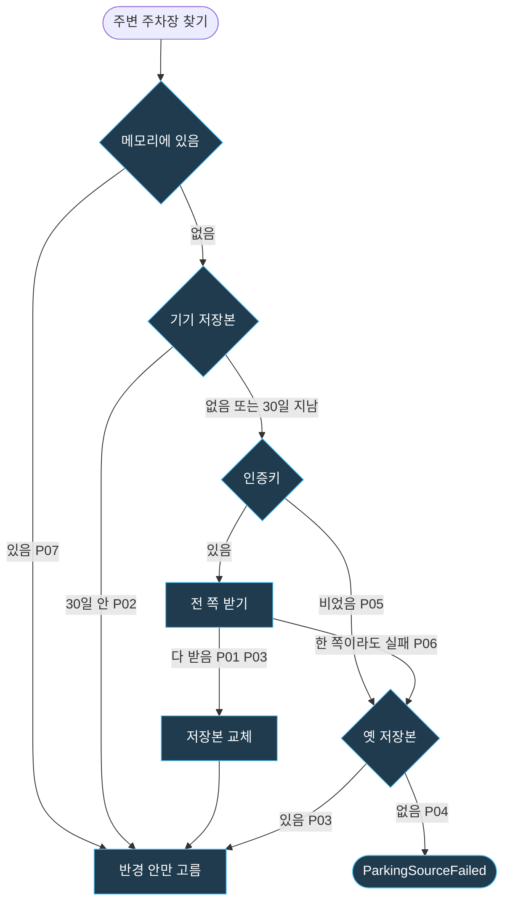

# 공공 주차장 데이터 연결 스펙

pleos 빌드의 주차장 데이터를 기획서 24절의 가상 데이터에서 공공데이터포털 「전국주차장정보표준데이터」(오픈API `https://api.data.go.kr/openapi/tn_pubr_prkplce_info_api`, 2026-11-09 데이터셋 메타데이터로 확인)로 바꾼다. mock 빌드는 가상 데이터를 그대로 쓴다. 규칙(R1~R10)은 [주차장 안내 스펙](parking-guidance.md)이 정본이고, 이 파일은 데이터를 어디서 받아 어떤 값으로 옮기는지만 정한다.

`[가설]`은 사람이 확인하기 전인 줄이다. 2026-11-09 사용자 결정 네 가지(전국 데이터를 받아 기기에 저장, 위치 좌표를 입구로, 도착 예정일 요일로 운영 시간 선택, 연결 주차장은 비움)는 확정이다. 필드명·응답 형식·쪽 크기는 같은 날 인증키로 받은 실제 응답(전체 18,994건)으로 확인했다. `[가설: 데이터 근거]`는 실제 데이터의 분포에서 읽어 낸 해석이라 사람의 확인이 남은 줄이다.

이 파일도 parking-guidance.md와 같은 이유로 저장소에 둔다(허브의 열린 질문 "스펙을 허브 옆으로 옮길지"가 정해지면 같이 옮긴다).

## 무엇이 되면 끝인가

pleos 빌드에서 내비 목적지를 찍으면, 그 주변(R2 반경) 공공 주차장이 S02에 나오고, 하나를 골라 안내를 시작하면 차량 도착지가 그 주차장 좌표로 바뀐다.

## 왜 전국 데이터를 받아 두나

내비가 주는 목적지에는 이름·좌표·남은 시간만 있고 주소가 없다. Pleos 에뮬레이터에는 Google 서비스가 없어 좌표를 주소로 바꿀 지오코더도 없다. API는 좌표 반경 조건을 받지 않는다 `[가설]`(요청 변수 문서는 아직 못 봤다). 그래서 목적지마다 지역을 골라 부르지 않고, 전국 데이터를 한 번 받아 기기에 저장한 뒤 반경 검색을 기기에서 한다. 표준데이터는 반기 갱신이다.

## P1. 받기와 저장

| 상황 | 결과 |
|---|---|
| 저장본 없음 | 1쪽부터 `totalCount`만큼 받을 때까지 쪽마다 1000행씩 받는다(1000이 상한, 넘기면 결과 코드 10). 다음 쪽이 NODATA(03)면 거기서 멈춘다. 다 받으면 저장하고 그 데이터로 찾는다. 2026-11-09 기준 19쪽, curl로 5초, 저장본 11.6MB |
| 저장본이 30일 안 | API를 부르지 않는다 `[가설: 30일]` |
| 저장본이 30일 지남 | 다시 받는다. 다 받으면 저장본을 바꾼다 |
| 다시 받기가 실패, 옛 저장본 있음 | 옛 저장본으로 찾는다 `[가설]` |
| 저장본 없음 + 받기 실패 | `ParkingSourceFailed` (S02 오류 표시) |
| 인증키가 비었음 | 호출하지 않고 `ParkingSourceFailed` |
| 받는 도중 한 쪽이라도 실패 | 아무것도 저장하지 않는다(일부만 저장 금지) |
| 응답이 인증 오류 봉투(`OpenAPI_ServiceResponse`), 또는 결과 코드가 00·03이 아님 | 실패로 본다 |
| 같은 앱 실행 안에서 다시 찾기 | 기기 저장본을 다시 읽지 않고 메모리 값을 쓴다 |
| 동시에 두 번 찾기 | 받기는 한 번만 한다 |

## P2. 행 → 시설

| 원본 필드 (실제 응답으로 확인) | 앱 값 |
|---|---|
| `prkplceNo` 관리번호 | `id = "pub:<번호>"`. 같은 번호가 또 나오면 첫 행만 쓴다(실제 1,116건 중복) |
| `prkplceNm` 주차장명 | `name`. 비었으면 그 행을 버린다 `[가설]` |
| `latitude`·`longitude` | `location`. 비었거나 0이거나 숫자가 아니면 그 행을 버린다(실제 750건) |
| (입구 좌표 없음) | `entrance = location` (사용자 결정) |
| `prkplceType` 노상·노외·부설 | ON_STREET·OFF_STREET·ATTACHED, 그 밖은 UNKNOWN |
| (주차 방식 없음) | `method = UNKNOWN`. "방식 미확인 포함" 기본값이 켜짐이라 목록에 나온다 |
| (차량 제한 없음) | `restrictions` 비움 → R1 "제한 정보 없음" UNKNOWN |
| `rdnmadr`, 없으면 `lnmadr` | `address` |
| `institutionNm` 관리기관명 | `operator` |
| `parkingchrgeInfo` 무료 | 요금 0원 (`FeeModel(0, 0, 0, 0)`) |
| 유료 + `basicTime`·`basicCharge`·`addUnitTime`·`addUnitCharge` 모두 숫자 | `FeeModel(기본분, 기본료, 추가분, 추가료)`. `dayCmmtkt`(1일 주차권)이 0보다 크면 일 최대 요금으로 본다 `[가설]` |
| 유료인데 위 값 중 하나라도 비었거나 숫자가 아님 | 요금 산출 불가(`null`). 실제 유료 5,325건 중 1,231건이 추가 단위 요금 없이 기본 요금만 있다 `[가설]` |
| 혼합(실제 700건)·그 밖의 값 | 요금 산출 불가(`null`) `[가설]` |
| `operDay`(예: 평일+토요일)에 그 요일(평일·토요일·공휴일)이 없음 | 그 요일 휴무 → R6 CLOSED → 후보에서 빠짐 `[가설: 데이터 근거]`. 실제로 휴무 요일은 00:00~00:00으로 오고, 토요일 690건·공휴일 1,510건 모두 operDay에 그 요일이 없었다 |
| 운영 시간 `HH:MM` 시작·종료 | `OperatingSchedule(시작, 종료)` |
| 00:00~23:59 또는 00:00~24:00 | 종일 운영 |
| 종료가 24:00 (시작은 00:00이 아님) | 그날 끝까지 운영 |
| 시작·종료가 비었거나 형식이 다름 | 그 요일 운영 시간 모름(`null`) |
| 시작 = 종료, 또는 종료가 시작보다 이름(밤샘 운영) | 그 요일 운영 시간 모름(`null`) `[가설]`. 0시 넘김을 판정하지 않으므로 잘못 제외하지 않으려고 |
| (잔여 대수 없음) | `availability`는 `null` → R4 UNAVAILABLE |
| (목적지와의 관계 없음) | 연결 주차장은 항상 빈 목록 (사용자 결정, R2 "검증된 관계만") |

평일·토요일·공휴일 운영 시간 필드: `weekdayOperOpenHhmm`·`weekdayOperColseHhmm`, `satOperOperOpenHhmm`·`satOperCloseHhmm`, `holidayOperOpenHhmm`·`holidayCloseOpenHhmm` (원본 표기 그대로, 오타 포함).

응답 형식: `{"header":{"resultCode":"00"},"body":{"items":{"item":[...]},"numOfRows":1000,"pageNo":1,"totalCount":18994}}`. `response`로 감싸지 않는다. 테스트 자료 `data/parking/src/test/resources/public-parking-page1.json`이 실제 첫 쪽 3행이다.

## P3. 요일별 운영 시간 (R6 보강)

| 상황 | 결과 |
|---|---|
| 도착 예정 시각이 월~금 | 평일 운영 시간으로 R6 판정 |
| 토요일 | 토요일 운영 시간 |
| 일요일 | 공휴일 운영 시간. 법정 공휴일 달력은 쓰지 않는다 (사용자 결정) |
| 그 요일 운영 시간이 없음 | UNKNOWN → 경고만 |
| 그 요일 휴무 | CLOSED → 후보에서 빠짐 |
| 가상 데이터처럼 운영 시간을 하나만 준 시설 | 매일 같은 값 |

## P4. 빌드 배선

| 빌드 | 주차장 데이터 |
|---|---|
| mock | 가상 데이터(`SampleParkingRepository`) 그대로. mock 패널 만차 시나리오도 그대로 |
| pleos | 공공 데이터. 인증키는 `local.properties`의 `parking.serviceKey`(공공데이터포털 일반 인증키) → BuildConfig. 키는 APK에 들어간다 |

## 흐름도

이번 작업이 처음 만드는 갈래라 전부 `changed`다. 행 변환(P2)과 요일 선택(P3)은 갈래가 아니라 표로 끝낸다.

## ID 표

| ID | 테스트 표시 이름 | 갈래 설명 |
|---|---|---|
| P01 | PublicParkingRepositoryTest.저장본이 없으면 전 쪽을 받아 저장하고 그 데이터로 찾는다 · 실제 응답 한 쪽을 읽는다 · 동시에 두 번 찾아도 한 번만 받는다 · 같은 관리번호는 첫 행만 쓴다 | 첫 받기 |
| P02 | PublicParkingRepositoryTest.저장본이 30일 안이면 API를 부르지 않는다 | 저장본 재사용 |
| P03 | PublicParkingRepositoryTest.저장본이 30일 지났으면 다시 받는다 · 다시 받기가 실패하면 옛 저장본으로 찾는다 | 갱신·갱신 실패 |
| P04 | PublicParkingRepositoryTest.저장본도 없고 받기도 실패하면 ParkingSourceFailed | 첫 받기 실패 |
| P05 | PublicParkingRepositoryTest.인증키가 비었으면 호출하지 않고 실패한다 | 키 없음 |
| P06 | PublicParkingRepositoryTest.둘째 쪽이 실패하면 아무것도 저장하지 않는다 · 인증 오류 봉투는 실패로 본다 | 일부 저장 금지 |
| P07 | PublicParkingRepositoryTest.반경 안 시설만 돌려준다 · 연결 주차장은 비어 있고 잔여는 미제공이다 | 반경·연결·잔여 |
| P08 | PublicParkingRowTest.유형과 좌표를 옮기고 입구는 위치 좌표다 · 좌표가 비었거나 0이거나 숫자가 아닌 행은 버린다 · 이름이 빈 행은 버린다 | 행 변환 |
| P09 | PublicParkingRowTest.무료는 0원 · 유료 값이 다 있으면 요금 모델이고 1일 주차권은 일 최대 요금이다 · 유료 값이 빠지거나 혼합이면 산출 불가 | 요금 변환 |
| P10 | PublicParkingRowTest.24시간 표기는 종일 운영이고 24시 종료는 그날 끝까지다 · 요일별 운영 시간을 따로 옮기고 비거나 형식이 다르면 그 요일은 모름 · 밤샘 운영이나 시작과 종료가 같으면 그 요일은 모름 · 운영 요일에 없는 요일은 휴무다 | 운영 시간 변환 |
| P11 | SearchParkingTest.토요일 도착이면 토요일 운영 시간으로 판정한다 · 일요일 도착이면 공휴일 운영 시간으로 판정한다 · 그 요일 운영 시간이 없으면 UNKNOWN · 그 요일이 휴무면 CLOSED로 후보에서 빠진다 | 요일 선택 |
| P12 | | pleos 빌드 배선과 실제 API 호출. 2026-11-09 Pleos 에뮬레이터에서 확인(단위 테스트 없음): 저장본 없이 시작해 약 10초에 받아 저장, 목적지 "송정역 5호선" 반경 500m 0곳 · 1km 신방화역 782m 1곳(전국 데이터로 계산한 기대값과 같음) |

## 빈칸 (사람이 정할 것)

- 저장본 유효 기간 30일이 맞는지.
- 다시 받기가 실패했을 때 옛 저장본을 조용히 쓸지, 화면에 "데이터 기준일" 경고를 붙일지. 지금은 조용히 쓴다.
- 첫 받기 약 10초(에뮬레이터, 앱 시작부터 저장까지)가 시연에 괜찮은지.
- 휴무 요일 해석(operDay에 없으면 휴무)이 맞는지.
- 기본 요금만 있고 추가 단위 요금이 없는 유료 1,231건을 산출 불가로 둘지, 기본 요금 고정으로 볼지.
- 요금 '혼합'을 산출 불가로 둘지.
