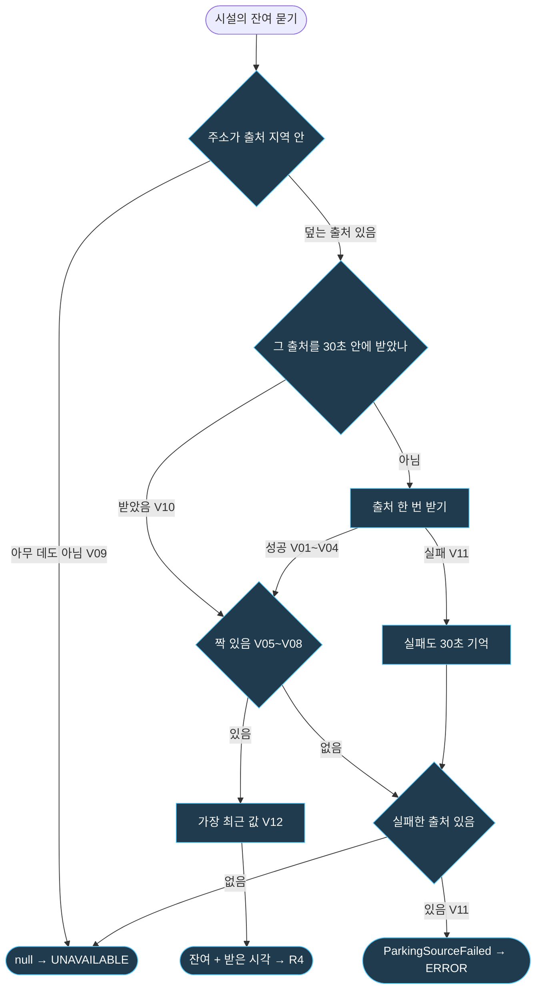

# 실시간 잔여 대수 연결 스펙

pleos 빌드의 주차장 목록(전국주차장정보표준데이터, [공공 데이터 스펙](public-parking-data.md))에는 남은 자리가 없다. 남은 자리를 실시간으로 주는 공공 API를 붙여, 짝을 찾은 주차장에만 잔여 대수를 채운다. 잔여 상태 판정(LIVE·RECEIVED·STALE·UNAVAILABLE·ERROR)은 [주차장 안내 스펙](parking-guidance.md) R4가 정본이고, 이 파일은 어느 출처에서 받아 어느 시설에 붙이는지만 정한다.

2026-11-14 사용자 결정 세 가지는 확정이다: 알 수 있는 실시간 API는 모두 붙인다, 겹치거나 부정확한 출처(올림픽공원, 공항 면 단위 API)는 뺀다, 표준데이터 시설과 짝을 찾은 곳에만 붙이고 짝 없는 실시간 주차장은 버린다. 같은 날 사용자가 교통안전공단·부산시설공단·대전 세 곳을 활용신청했고, 나머지(서울·대구 수성구·진주·강릉)는 일단 뺐다. 세 출처의 필드와 봉투는 2026-11-14 실제 응답으로 확인했다.

## 무엇이 되면 끝인가

pleos 빌드에서 주차장이 S02에 나올 때, 그 주차장이 실시간 출처에 있으면 "정보 미확인" 대신 남은 자리가 보인다.

## V1. 출처

| 출처 | 지역(시설 주소 앞부분) | 남은 자리 | 원본 갱신 시각 | 좌표 | 2026-11-14 실제 응답 |
|---|---|---|---|---|---|
| 한국교통안전공단 `PrkRealtimeInfo_v1`(JSON) | 시도마다 출처 하나. 지역은 앱에 넣은 표의 시도 이름 | `pkfc_Available_ParkingLots_total`을 `pkfc_ParkingLots_total`로 자른다 | 없음 | 표에서 | 전국 4,648곳 중 시설정보가 있는 곳 677곳이 표에 들어갔고, 표준데이터와 짝이 맞는 곳은 290곳 |
| 부산시설공단 `getParkingInfoList_v2`(XML) | 부산광역시 | `curravacnt` | `lastupdatetime`(`yyyy-MM-dd HH:mm:ss`) | 없음 | 48곳. 갱신 시각이 모두 2026-11-11 17:50에서 멈춰 있어 R4가 STALE로 판정한다. 표준데이터와 짝이 맞는 곳 0곳 |
| 대전 `pis/parkinglotIF`(XML) | 대전광역시 | `resQty`를 `totalQty`로 자른다 | 없음 | `lat`·`lon` | 756곳 중 `totalQty`가 있는 곳 13곳. 짝이 맞는 곳 4곳 |

교통안전공단 실시간 응답에는 ID와 면수만 있다. 이름·좌표는 시설정보(`PrkSttusInfo_v1`, 전국 1,706,731건)에만 있어 앱이 받을 수 없으므로, `scripts/build_ts_realtime_lots.py`가 실시간 ID에 해당하는 행만 뽑아 `data/parking/src/main/resources/ts-realtime-lots.json`(약 50KB)으로 넣는다. 시설정보에 이름·좌표가 빈 206곳과 시설정보가 없는 ID는 표에 없다. 실시간 목록이 바뀌면 스크립트를 다시 돌린다. ID 형식(`10000-11191-00001-00-1`)은 표준데이터 관리번호(`236-2-000066`)와 달라 V2의 이름·좌표 짝 맞추기를 쓴다. 시도 코드 12는 전남광주통합특별시이고, 표준데이터 주소에 남은 옛 이름(광주광역시·전라남도, 강원도, 전라북도)도 그 시도의 지역으로 넣는다.

| 상황 | 결과 |
|---|---|
| 교통안전공단·대전에서 총면수가 비었거나 0 | 실시간이 없는 곳이다. 그 행을 버린다(대전은 이런 행의 `resQty`가 0이라 만차로 읽으면 안 된다) |
| 남은 자리가 총면수보다 큼(교통안전공단에 있다) | 총면수로 자른다 |
| 남은 자리 값이 비었거나 숫자가 아님, 이름이 비었음 | 그 행을 버린다 |
| 교통안전공단 행의 ID가 표에 없음 | 버린다 |
| 인증 오류 봉투(`OpenAPI_ServiceResponse`), 결과 코드가 00·0이 아님 | 그 출처 실패 |
| 결과 코드 03(NODATA) | 행 없음(실패 아님) |
| 첫 쪽의 `totalCount`가 받은 행보다 많음 | 나머지 쪽을 한꺼번에 받는다. 대전은 `numOfRows`를 크게 줘도 50건씩만 준다 |

범위에서 뺀 것과 이유:

- 서울 열린데이터광장 시영주차장, 대구 수성구, 진주, 강릉: 2026-11-14 사용자 결정으로 일단 뺐다. 서울은 샘플 키 응답(`PKLT_NM`, `TPKCT − NOW_PRK_VHCL_CNT`, `NOW_PRK_VHCL_UPDT_TM`, `PRK_STTS_YN`=1만 실시간, http만 받음)까지 확인했었다.
- 순천 교통정보: 운영 정보만 있고 남은 자리 수가 없다.
- 한국공항공사 14개 공항, 인천공항 주차 정보, 강원랜드 광장주차장: 표준데이터에 그 주차장이 없어 "짝 찾은 곳에만" 규칙으로는 붙일 곳이 0곳이다(2026-11-14 표준데이터 18,994건 대조). 빈칸 참고.
- 교통안전공단 시설정보의 주소로 짝 맞추기: 이름·좌표가 빈 행을 주소로 맞춰 보면 강원·전북 47곳 중 1곳만 맞아 넣지 않았다.

## V2. 짝 맞추기

| 상황 | 결과 |
|---|---|
| 이름 비교 | 괄호 안 글자와 공백을 지우고, 끝의 "주차장"·"공영"을 더 떼어지지 않을 때까지 뗀 뒤 같으면 같은 이름. 예: "종묘주차장 공영주차장(시)" = "종묘" |
| 시설 주소가 출처 지역으로 시작하지 않음 | 짝짓지 않는다 |
| 좌표 없는 출처, 지역 안에 같은 이름 시설이 하나 | 그 시설과 짝 |
| 좌표 없는 출처, 지역 안에 같은 이름 시설이 둘 이상 | 짝 없음 |
| 좌표 주는 출처 | 같은 이름 시설 중 300m 안에서 가장 가까운 것 `[가설: 300m]`. 없으면 짝 없음 |
| 한 출처의 두 행이 같은 시설에 짝지어짐 | 그 시설은 짝 없음 `[가설]` |
| 정규화한 이름이 빈 문자열 | 짝 없음 |

## V3. 읽기·보관·실패

| 상황 | 결과 |
|---|---|
| 시설 주소가 어느 출처 지역에도 없음 | 아무 출처도 부르지 않는다 → null → R4 UNAVAILABLE |
| 출처를 받은 지 30초 안 | 다시 받지 않고 그때 결과를 쓴다 `[가설: 30초]`. R4의 "수신 2분"보다 짧게 둔다 |
| 30초 지남 | 다시 받는다. 받은 시각이 새 수신 시각이다 |
| 짝 있음 | 잔여 대수, 원본 갱신 시각(있으면), 받은 시각을 R4로 넘긴다 |
| 출처 실패 | 실패도 30초 동안 기억해 다시 부르지 않는다 |
| 덮는 출처 중 하나라도 짝을 찾음 | 그 값. 둘 이상이면 원본 갱신 시각(없으면 받은 시각)이 가장 최근인 값 |
| 짝 없음 + 실패한 출처 있음 | `ParkingSourceFailed` → R4 ERROR |
| 짝 없음 + 실패 없음 | null → R4 UNAVAILABLE |
| 같은 출처를 동시에 둘이 물음 | 받기는 한 번만 |
| 원본 갱신 시각의 시간대 | 한국 시각으로 읽는다 |

## V4. 빌드 배선

| 빌드 | 실시간 출처 |
|---|---|
| mock | 쓰지 않는다. 가상 데이터의 잔여 그대로 |
| pleos, `parking.serviceKey` 있음 | 부산시설공단, 대전, 교통안전공단(표의 시도마다 하나) |
| 키가 비었음 | 출처가 없다(지역에 들어도 부르지 않음) |

## 흐름도

이번 작업이 처음 만드는 갈래라 전부 `changed`다. 출처별 필드(V1)는 갈래가 아니라 표로 끝낸다.

## ID 표

| ID | 테스트 표시 이름 | 갈래 설명 |
|---|---|---|
| V01 | RealtimeParsersTest.교통안전공단은 표에서 이름과 좌표를 찾고 총면수를 넘는 값은 자른다 · 교통안전공단 표에 없는 ID는 버린다 | 교통안전공단 |
| V02 | RealtimeParsersTest.대전은 총면수가 있는 행만 읽는다 · RealtimeSourcesTest.대전은 첫 쪽의 전체 건수를 보고 나머지 쪽을 받는다 | 대전 |
| V03 | RealtimeParsersTest.부산은 주차 가능 대수와 갱신 시각을 읽고 대수가 빈 행은 버린다 | 부산 |
| V04 | ApiRowsTest.XML 응답에서 item 행과 전체 건수를 읽는다 · 교통안전공단 JSON은 최상위 배열이 행이다 · 결과 코드 03은 빈 목록이다 · 인증 오류 봉투와 오류 결과 코드는 실패다 | 응답 봉투 |
| V05 | RealtimeMatcherTest.괄호와 공백과 끝의 주차장 공영을 떼고 이름을 비교한다 | 이름 정규화 |
| V06 | RealtimeMatcherTest.지역 안에 같은 이름이 하나뿐이면 짝짓는다 · 같은 이름이 둘이면 짝짓지 않는다 · 지역 밖 시설과는 짝짓지 않는다 | 좌표 없는 짝 |
| V07 | RealtimeMatcherTest.좌표가 있으면 300m 안의 가장 가까운 같은 이름과 짝짓는다 | 좌표 있는 짝 |
| V08 | RealtimeMatcherTest.두 행이 한 시설에 짝지어지면 그 시설은 짝 없음 | 겹친 짝 |
| V09 | RealtimeAvailabilityTest.어느 출처 지역에도 없으면 부르지 않고 null | 지역 밖 |
| V10 | RealtimeAvailabilityTest.짝이 있으면 받은 시각과 함께 잔여를 준다 · 30초 안에는 다시 받지 않고 지나면 다시 받는다 · 동시에 물어도 한 번만 받는다 | 보관 |
| V11 | RealtimeAvailabilityTest.출처가 실패하면 ParkingSourceFailed이고 30초 동안 다시 부르지 않는다 · 다른 출처에 짝이 있으면 실패를 덮는다 | 실패 |
| V12 | RealtimeAvailabilityTest.두 출처에 다 짝이 있으면 더 최근 값을 쓴다 | 겹친 출처 |
| V13 | PublicParkingRepositoryTest.실시간 출처가 있으면 그 시설의 잔여를 물어 준다 | 저장소 연결 |
| V15 | RealtimeSourcesTest.키가 비면 출처가 없다 · 부산 대전과 교통안전공단 시도마다 출처를 만든다 · 교통안전공단은 그 시도 코드로 JSON을 받는다 · 앱에 넣은 교통안전공단 표를 읽는다 | 출처 목록 |
| V14 | | 출처별 실제 호출과 짝 비율. 2026-11-14 실제 응답으로 확인했다(V1 표의 숫자). 단위 테스트 없음 |

## 빈칸 (사람이 정할 것)

- 공항(한국공항공사 14개 공항·인천공항)과 강원랜드: 표준데이터에 짝이 없어 지금 규칙으로는 붙지 않는다. 뺄지, 이 출처만 새 시설로 넣을지.
- 부산시설공단: 표준데이터와 짝이 0곳이라 지금은 붙는 곳이 없다. 출처를 둘지 뺄지.
- 이름 맞추기 규칙과 300m: 교통안전공단 677곳 중 290곳이 맞는다. 더 맞추려면 규칙을 넓혀야 한다.
- 보관 30초가 맞는지.
- 교통안전공단의 "남은 자리 0": 표에 있는 674곳 중 76곳이 0이었고, 18분 뒤 다시 받았을 때 75곳이 그대로였다(2026-11-14 토요일 23시). 실제 만차인지 값을 보내지 않는 곳인지 가릴 수 없어 지금은 받은 그대로 0대로 쓴다. 정보 없음으로 볼지.
